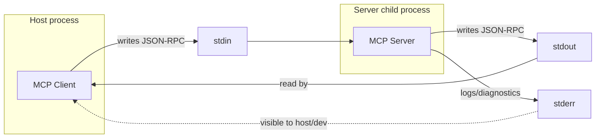
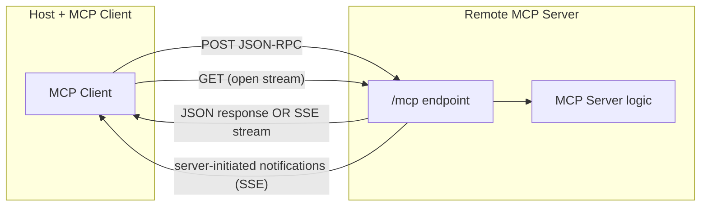
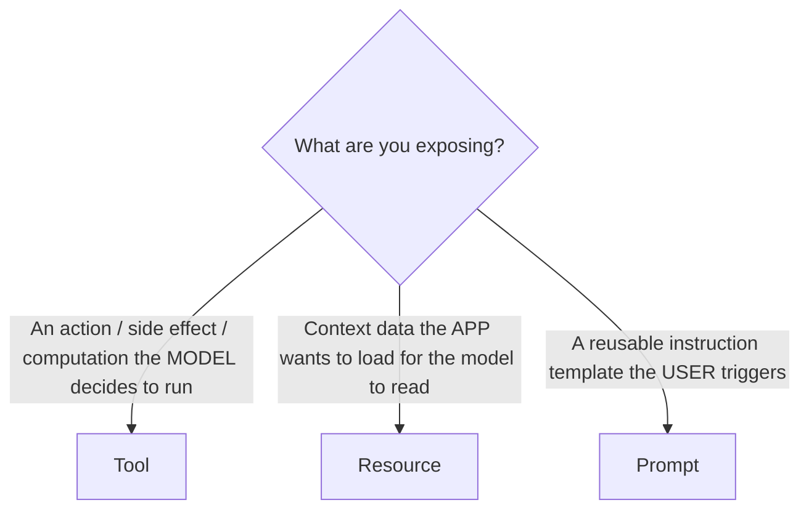

# Chapter 4 — MCP Transports and Communication

A **transport** is just the pipe that carries JSON-RPC messages between client and server. MCP deliberately separates the *protocol* (what the messages mean) from the *transport* (how bytes move). **[SPEC]** This is why the same server logic can run locally over STDIO or remotely over HTTP with minimal changes.

The two transports you need to know:

| Transport | Where server runs | Primary use |
|-----------|-------------------|-------------|
| **STDIO** | Local child process of the host | Local tools, dev, CLIs, desktop apps |
| **Streamable HTTP** | Remote (or local) HTTP service | Hosted/multi-user servers, cloud |

> **[VERIFY]** An older transport called **HTTP+SSE** (two endpoints: a `GET /sse` stream + a `POST` endpoint) was defined in earlier spec revisions and has been **superseded by Streamable HTTP**. You'll still encounter HTTP+SSE in older servers/clients. Treat it as **legacy** and confirm current status/back-compat rules in the live spec before targeting it.

---

## 4.1 STDIO Transport

### What it is
The host **launches the server as a child process** and communicates by writing JSON-RPC to the child's **stdin** and reading responses from its **stdout**. **[SPEC]** One message per line (newline-delimited JSON). No sockets, no ports, no network.



### How it works internally
1. The host runs a command like `node build/index.js` (or `npx some-server`), optionally with args and environment variables.
2. The host pipes the child's stdin/stdout.
3. Messages are **newline-delimited JSON** on stdout; the client reads line by line. **[SPEC]**
4. The child inherits/gets a controlled environment and working directory decided by the host.

### The #1 STDIO rule: stdout is sacred
**stdout must contain ONLY valid JSON-RPC messages.** **[SPEC]** If your code (or a dependency) does `console.log("Starting...")`, that text lands on stdout, corrupts the JSON stream, and the client either errors or silently desyncs. This is the single most common STDIO bug.

- **Diagnostics/logs → `stderr`** (`console.error`) **[SPEC/ENG]**, or
- Use the MCP **logging capability** (`notifications/message`) to send structured logs over the protocol (Chapter 3.8).

```ts
// ❌ WRONG — corrupts the protocol stream
console.log("Server started");

// ✅ CORRECT — stderr is safe for human-readable logs
console.error("Server started");
```

### Process lifecycle & termination
- **Startup:** host spawns the process; if the binary isn't found or exits immediately, the client sees startup failure.
- **Shutdown:** the host closes the child's **stdin**; the server should detect EOF and exit cleanly. The host may then send `SIGTERM`, and `SIGKILL` if it doesn't exit. **[SPEC]**
- **Crash detection:** if the process exits unexpectedly, the client observes the closed pipe / non-zero exit and treats the connection as dead.

### Environment variables & arguments
The host passes configuration via **command args** and **environment variables** in its client config (Chapter 7/8). **[CLIENT]** By default a spawned process may *not* inherit the full parent environment — clients often pass a restricted `env`. Don't assume `$HOME`, `$PATH`, or your shell profile are present.

### Startup failure handling
Common failure modes and what the client sees:

| Failure | Symptom |
|---------|---------|
| Command not found | Spawn error, immediate disconnect |
| Throws before transport connects | Non-zero exit, no protocol handshake |
| Logs to stdout | Parse errors / garbage messages |
| Wrong cwd (can't find DB/file) | Server exits or tool calls fail |

### Graceful shutdown (STDIO) — pattern
```ts
function installShutdown(cleanup: () => Promise<void>) {
  const handler = async () => {
    try { await cleanup(); } finally { process.exit(0); }
  };
  process.on("SIGINT", handler);
  process.on("SIGTERM", handler);
  // stdin end = host closed the pipe
  process.stdin.on("end", handler);
}
```

---

## 4.2 Streamable HTTP Transport

### What it is
The server is an **HTTP service** exposing a single MCP endpoint (commonly `/mcp`). **[VERIFY]** Clients send JSON-RPC via **HTTP POST**; the server responds either with a single JSON response **or** upgrades to a **Server-Sent Events (SSE)** stream when it needs to send multiple messages (e.g. progress notifications, then the final result). The client can also open a **GET** to the same endpoint to receive server-initiated messages. **[SPEC/VERIFY]**



### Request/response handling
- **POST** with a JSON-RPC request → server returns:
  - a single JSON body (`Content-Type: application/json`) for simple request/response, **or**
  - an SSE stream (`Content-Type: text/event-stream`) carrying one or more messages ending with the response. **[SPEC/VERIFY]**
- **POST** with a *notification* (no `id`) → server returns `202 Accepted` with no body. **[VERIFY]**

### Session management
The server may assign a **session ID** on `initialize`, returned in a response header (commonly `Mcp-Session-Id`). **[VERIFY]** The client echoes it on subsequent requests. Sessions let a stateful server tie requests together. A `DELETE` to the endpoint can terminate a session. **[VERIFY]**

### Streaming behavior (SSE)
SSE is used so the server can stream **progress notifications, log messages, and partial content** before the final result on a single logical request. The final JSON-RPC response closes that stream. **[SPEC]**

### Stateless vs stateful deployment
| Mode | Session ID | State | Scaling |
|------|-----------|-------|---------|
| **Stateless** | None/ephemeral | No per-connection server state | Trivial horizontal scaling; any instance serves any request |
| **Stateful** | Yes | Keeps session/subscription state in memory | Needs session affinity or shared state store |

**[ENG]** Prefer **stateless** for production HTTP servers when possible — it scales horizontally without sticky sessions. Push any needed state to a shared store (DB/Redis). Use stateful only when you truly need server-push subscriptions tied to a connection.

### Authentication & authorization
HTTP transport is where real auth lives. **[SPEC]** MCP defines an **OAuth 2.1-based authorization** model for HTTP servers: the server is an OAuth **resource server**, and clients present **Bearer access tokens** in the `Authorization` header. Full treatment in Chapter 12. STDIO servers generally rely on **local process trust** instead.

### Reverse proxies & load balancers
**[ENG]** When fronting with nginx/Envoy/ALB:
- **Disable response buffering** for the SSE path, or streaming breaks (you'll get the full stream only at the end, or a timeout).
- Set generous **read/idle timeouts** for long-lived SSE connections.
- Preserve the `Authorization`, `Mcp-Session-Id`, and `MCP-Protocol-Version` headers. **[VERIFY]**
- If stateful, configure **session affinity** keyed on the session ID.

Example nginx snippet for the MCP endpoint:
```nginx
location /mcp {
    proxy_pass http://mcp_upstream;
    proxy_http_version 1.1;
    proxy_set_header Connection "";
    proxy_buffering off;              # critical for SSE streaming
    proxy_read_timeout 3600s;        # long-lived streams
    proxy_set_header Authorization $http_authorization;
    proxy_set_header Mcp-Session-Id $http_mcp_session_id;
}
```

### Connection termination & reconnection
- Client closes POST/GET streams when done.
- `DELETE /mcp` with a session ID ends the session. **[VERIFY]**
- **[VERIFY]** Streamable HTTP supports **resumability** via SSE event IDs and a `Last-Event-ID` header so a dropped stream can resume without losing messages. Confirm current support in the SDK before relying on it.

### HTTP status codes & protocol errors
Two layers again (Chapter 3.4):

| Situation | HTTP status | JSON-RPC |
|-----------|-------------|----------|
| Valid request processed | 200 | result or error in body |
| Notification accepted | 202 | (no body) |
| Missing/invalid auth | 401 (+ `WWW-Authenticate`) | — |
| Forbidden | 403 | — |
| Bad session | 404 | — **[VERIFY]** |
| Malformed body | 400 | parse/invalid-request error |

**[ENG]** HTTP status reports *transport/auth* outcomes; JSON-RPC `error`/`result` reports *protocol/application* outcomes. Don't conflate them.

### Production networking considerations
- **Always TLS** in production (HTTPS). Never expose plaintext.
- Validate the **`Origin`** header to prevent DNS-rebinding/browser-based attacks when running locally-bound servers. **[SPEC]**
- Bind local-only servers to `127.0.0.1`, not `0.0.0.0`. **[SPEC/ENG]**
- Enforce request size limits, rate limits, and timeouts (Chapters 11, 17).

---

## 4.3 Transport comparison table

| Dimension | STDIO | Streamable HTTP |
|-----------|-------|-----------------|
| Execution | Local child process | Local or remote service |
| Network exposure | None | Yes (secure it) |
| Auth model | Local process trust | OAuth 2.1 / Bearer tokens **[VERIFY]** |
| Security surface | Small (local only) | Large (network, auth, multi-tenant) |
| Deployment complexity | Minimal | High (TLS, proxy, scaling, secrets) |
| Latency | Lowest (no network) | Network-bound |
| Scalability | One process per client | Horizontal (prefer stateless) |
| Multi-user | No | Yes |
| Debugging | Inspector, stderr logs | Inspector, HTTP logs, tracing |
| Streaming/push | Over the single pipe | SSE |
| Client compatibility | Universal (all MCP clients) | Supported clients; auth adds requirements |
| Recommended for | Desktop apps, dev, local tools, CLIs | Hosted/SaaS, shared servers, cloud |

**Rule of thumb [ENG]:** build locally with STDIO, deploy shared/multi-user with Streamable HTTP. Keep your *business logic* transport-agnostic (Chapter 6) so switching is a thin entry-point change.

---

# Chapter 5 — MCP Tools, Resources, and Prompts

Recall the control model from Chapter 2:

| Capability | Controlled by | Think of it as |
|-----------|---------------|----------------|
| **Tool** | Model | A function the model may call (actions, computation) |
| **Resource** | Application | Context data the app loads into the model |
| **Prompt** | User | A reusable template the user invokes |

Getting this distinction right is the difference between an MCP server that feels natural and one that fights the client.

---

## 5.1 Tools

### 5.1.1 What tools are and discovery
A tool is a named, schema-described operation the model can invoke via `tools/call`. The client learns about tools via `tools/list`. **[SPEC]** If tools change at runtime, the server sends `notifications/tools/list_changed` (only if it advertised `tools.listChanged`). **[SPEC]**

### 5.1.2 Names and descriptions
- **Name:** stable, unique, machine-friendly (`create_task`, not "Create Task!"). This is an identity; changing it breaks callers.
- **Description:** written **for the model**. It's effectively prompt text — be precise about *what it does, when to use it, and what the arguments mean*. A vague description leads to misuse; an overly long one wastes context.

> ⚠️ **Security note:** tool names and descriptions can be an **attack vector** ("tool poisoning" — Chapter 11). A malicious server could embed instructions in a description. Hosts must treat server-provided text as untrusted.

### 5.1.3 Input schemas & JSON Schema validation
Each tool declares an `inputSchema` (JSON Schema). **[SPEC]** The schema serves two jobs:
1. Tells the model how to construct arguments.
2. Lets you validate incoming arguments server-side.

**[ENG] Never trust the model-generated arguments.** Validate them server-side even though a schema was advertised. In the TypeScript SDK you typically define Zod schemas and the SDK converts them to JSON Schema (Chapter 6). **[SDK]**

### 5.1.4 Execution & results
A tool returns a result with a `content` array of **content blocks** and an `isError` flag. **[SPEC]** Content block types include:

| Type | Use |
|------|-----|
| `text` | Plain/markdown text |
| `image` | Base64 image + mimeType |
| `audio` | Base64 audio **[VERIFY]** |
| `resource` / `resource_link` | Embed or reference a resource **[VERIFY]** |

### 5.1.5 Structured output
**[VERIFY]** Newer spec/SDK versions support **structured tool output** via an `outputSchema` and a `structuredContent` field, so the model (and your code) get typed JSON instead of only text. Confirm support in your SDK version; provide a `text` representation alongside for clients that don't read structured output.

### 5.1.6 Error results (not protocol errors!)
Business failures → `{ content: [...], isError: true }` (a successful JSON-RPC result). Protocol failures (unknown tool, bad params) → JSON-RPC `error`. (Chapter 3.4.) This lets the model *see and react to* failures.

### 5.1.7 Annotations / behavioral hints
**[VERIFY]** Tools may carry annotations such as `readOnlyHint`, `destructiveHint`, `idempotentHint`, `openWorldHint`, and a human `title`. These are **advisory hints for the host/UI** (e.g. "ask for confirmation before destructive tools") — they are **not security controls** and must never be trusted for authorization. Confirm exact annotation names in your SDK.

### 5.1.8 Long-running operations, idempotency, retries
- For long work, emit **progress notifications** (Chapter 3.7) and support **cancellation**.
- Mark genuinely idempotent tools so hosts can retry safely; mark destructive ones so hosts can confirm.
- **[ENG]** For non-idempotent side effects (payments, email, deletes), design **idempotency keys** so a retry doesn't double-execute (Chapter 10).

### 5.1.9 Naming & versioning
- Keep names stable; add new tools rather than silently changing behavior.
- If behavior must change incompatibly, consider a suffixed name (`search_tasks_v2`) or a version arg. **[OPT]**

### 5.1.10 Safe tool design (checklist)
- [ ] Validate all inputs server-side.
- [ ] Enforce authorization *inside* the handler, not via the description.
- [ ] Apply least privilege (narrow DB queries, scoped credentials).
- [ ] Limit output size; minimize returned data.
- [ ] Timeout and cancel downstream calls.
- [ ] Return actionable `isError` messages without leaking secrets/internals.

### 5.1.11 Five realistic tool examples
1. `create_task(title, priority?)` — writes to DB; non-idempotent; destructive-ish.
2. `search_tasks(query, limit?)` — read-only; safe to retry.
3. `track_shipment(trackingId)` — calls external API; read-only but open-world.
4. `send_notification(userId, message)` — side effect; needs idempotency key.
5. `get_task_stats()` — pure read/compute; read-only, idempotent.

---

## 5.2 Resources

### 5.2.1 What resources are
Resources are **readable pieces of context** identified by a URI, that the *application* chooses to feed to the model (not invoked by the model like tools). **[SPEC]** Discovery via `resources/list`; fetch via `resources/read`.

### 5.2.2 Resource URIs
Each resource has a `uri` (e.g. `task://stats/summary`, `file:///path`, `db://orders/42`). The scheme is yours to define. **[SPEC]** URIs should be stable and meaningful.

### 5.2.3 Resource templates
For parameterized resources, servers expose **resource templates** using RFC 6570 URI templates (e.g. `task://{taskId}`). **[SPEC]** The client/app expands the template to a concrete URI before reading.

### 5.2.4 Static vs dynamic
- **Static:** fixed content (a config doc).
- **Dynamic:** computed per-read (live stats, DB row, generated summary).

### 5.2.5 Content types & large resources
`resources/read` returns `contents[]`, each with `uri`, `mimeType`, and either `text` or `blob` (base64). **[SPEC]** For large data:
- Prefer pagination or summarization over dumping megabytes into context.
- Use `blob` only when binary is genuinely needed.
- Consider returning a `resource_link` from a tool instead of inlining huge content. **[VERIFY]**

### 5.2.6 Subscriptions & update notifications
If the server advertises `resources.subscribe`, clients can `resources/subscribe` to a URI and receive `notifications/resources/updated` when it changes. **[SPEC]** Use for live-changing data (logs, dashboards).

### 5.2.7 Authorization & sensitive resources
**[ENG]** Resources can expose sensitive data. Enforce per-resource authorization in the read handler, scoped to the authenticated user/tenant. Never list resources a user can't access, and re-check on read (listing and reading are separate requests).

### 5.2.8 Five realistic resource examples
1. `task://stats/summary` — JSON stats (dynamic).
2. `task://{taskId}` — a single task by ID (template, dynamic).
3. `doc://runbooks/incident-response` — static markdown doc.
4. `config://server/features` — current feature flags (dynamic).
5. `log://tasks/recent` — recent audit entries, subscribable (dynamic + updates).

---

## 5.3 Prompts

### 5.3.1 What prompts are
Prompts are **reusable, parameterized message templates** the server offers, typically surfaced to the **user** (e.g. as slash commands / menu entries). **[SPEC]** Discovery via `prompts/list`; retrieval via `prompts/get`.

### 5.3.2 Arguments
A prompt declares `arguments` (name, description, required?). The client collects them from the user and passes them to `prompts/get`. **[SPEC]**

### 5.3.3 Retrieval
`prompts/get` returns a `description` and a `messages[]` array (roles + content blocks) ready to send to the model. **[SPEC]** The server fills the template with the provided arguments (and may pull in data).

### 5.3.4 Dynamic prompts
A prompt can embed live data (e.g. fetch a task and build a triage prompt around it) and can include resource references in its messages. **[VERIFY]** This makes prompts a powerful way to package "the right context + the right instructions" for a recurring workflow.

### 5.3.5 Versioning & maintenance
- Keep prompt names stable.
- Treat prompt text like code: review changes, test output quality.
- **[ENG]** Track prompt versions so you can correlate output-quality changes to prompt changes.

### 5.3.6 Five realistic prompt examples
1. `triage_task(taskId)` — build a prompt asking the model to classify/prioritize a task.
2. `summarize_open_tasks()` — prompt to summarize all open tasks.
3. `draft_status_update(sprint)` — produce a stakeholder status update.
4. `plan_subtasks(taskId)` — break a task into subtasks.
5. `explain_overdue()` — explain which tasks are overdue and why.

---

## 5.4 Tool vs Resource vs Prompt — how to choose



| Question | If yes → |
|----------|----------|
| Does it *do* something or compute on demand, chosen by the model? | **Tool** |
| Is it *data to read* that the app selects into context? | **Resource** |
| Is it a *canned instruction/workflow* the user invokes? | **Prompt** |

Common mistakes:
- Making everything a tool (bloats the tool list, wastes context, confuses the model).
- Using a tool where a resource fits (e.g. `get_document` tool vs `doc://` resource) — resources keep model-controlled surface area smaller.
- Putting authorization logic only in prompt/description text (it's advisory, not enforced).

---