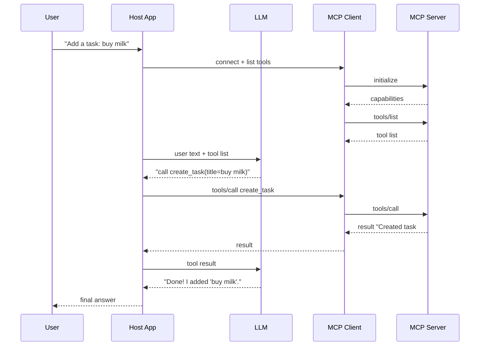

# Chapter 7 — Connect an MCP Server to an AI Client

We built a server. Now we connect it to an AI app. This chapter shows how an AI app finds the server, learns its tools, and uses them with an LLM.

## 7.1 The big picture

An AI app that uses MCP has these parts:

| Part | Job |
|------|-----|
| **Host app** | The program the user talks to |
| **LLM** | Picks which tool to call (the "brain") |
| **MCP client** | Talks to the MCP server using the protocol |
| **MCP server** | Does the real work (our task server) |

**Important:** MCP does **not** think. The **LLM** decides what to do. The MCP client just carries messages. Do not expect MCP to reason on its own. **[SPEC]**



## 7.2 The flow in words

1. User asks a question.
2. The app connects the MCP client to the server.
3. The client runs `initialize` and gets the server's capabilities.
4. The client calls `tools/list` to get the tools.
5. The app sends the user's text **and** the tool list to the LLM.
6. The LLM decides: answer directly, or call a tool.
7. If a tool is needed, the app asks the MCP client to call it.
8. The server runs the tool and returns a result.
9. The app sends the result back to the LLM.
10. The LLM writes the final answer for the user.

Steps 5, 6, and 10 are the **app's job** (model reasoning). Steps 3, 4, 7, 8 are **MCP's job** (protocol). Keep them separate in your mind and in your code.

## 7.3 Tool schemas and the LLM

The server gives the client a tool list with JSON Schemas. Most LLM providers want tools in their own format. So the app **translates** MCP tools into the LLM's "function" format. This is normal glue code. **[ENG]**

## 7.4 Connecting to multiple servers

One app can connect to many servers at once (tasks server, docs server, shipping server). The app merges all their tools into one list for the LLM.

**Problem: name collisions.** Two servers may both have a tool called `search`. Fix it by adding a prefix, like `tasks.search` and `docs.search`, when you build the list for the LLM. **[ENG]**

## 7.5 Context and size limits

- The tool list uses up context (tokens). If you have many tools, the list gets big. Keep descriptions short. Filter tools you don't need. **[ENG]**
- Tool results can be big too. If a result is huge, it can fill the context. Trim results in the server (we set limits in Chapter 6). The app can also cut long results. **[ENG]**

## 7.6 A full client example

We build a small client. It uses an **LLM adapter** so we can swap models. We keep the MCP part and the LLM part separate.

> **Note:** This uses a chat-style LLM with function calling. The LLM provider part is behind a small adapter. You plug in your provider's SDK there. **[VERIFY]** the MCP client SDK method names against current docs.

### Folder
```
mcp-task-client/
├── package.json
├── tsconfig.json
├── .env.example
└── src/
    ├── llm.ts        # LLM adapter (swap providers here)
    ├── mcpClient.ts  # connects to the MCP server
    └── index.ts      # the chat loop
```

### `src/mcpClient.ts`
```ts
// src/mcpClient.ts
// Connects to our MCP task server over STDIO and lists/calls tools.

import { Client } from "@modelcontextprotocol/sdk/client/index.js";
import { StdioClientTransport } from "@modelcontextprotocol/sdk/client/stdio.js";

export interface SimpleTool {
  name: string;
  description: string;
  inputSchema: unknown; // JSON Schema
}

export class TaskMcpClient {
  private client: Client;

  constructor() {
    this.client = new Client({
      name: "mcp-task-client",
      version: "1.0.0",
    });
  }

  // Start the server as a child process and connect.
  async connect(serverCommand: string, serverArgs: string[]) {
    const transport = new StdioClientTransport({
      command: serverCommand,
      args: serverArgs,
    });
    await this.client.connect(transport);
  }

  // Get all tools from the server.
  async listTools(): Promise<SimpleTool[]> {
    const result = await this.client.listTools();
    return result.tools.map((t) => ({
      name: t.name,
      description: t.description ?? "",
      inputSchema: t.inputSchema,
    }));
  }

  // Call one tool and return its text output.
  async callTool(name: string, args: Record<string, unknown>): Promise<string> {
    const result = await this.client.callTool({ name, arguments: args });

    // Pull out text content blocks.
    const text = (result.content ?? [])
      .filter((c: any) => c.type === "text")
      .map((c: any) => c.text)
      .join("\n");

    // If the tool reported an error, mark it so the LLM knows.
    if (result.isError) {
      return `TOOL ERROR: ${text}`;
    }
    return text;
  }

  async close() {
    await this.client.close();
  }
}
```

### `src/llm.ts`
```ts
// src/llm.ts
// A small adapter around any LLM with function calling.
// Replace the body with your provider's SDK.

export interface ToolSpec {
  name: string;
  description: string;
  parameters: unknown; // JSON Schema
}

export interface ChatMessage {
  role: "system" | "user" | "assistant" | "tool";
  content: string;
  toolCallId?: string;
  name?: string;
}

export interface ToolCall {
  id: string;
  name: string;
  arguments: Record<string, unknown>;
}

// What the LLM returns: either text, or a request to call tools.
export interface LlmReply {
  text?: string;
  toolCalls?: ToolCall[];
}

export interface Llm {
  chat(messages: ChatMessage[], tools: ToolSpec[]): Promise<LlmReply>;
}

// ---- Example adapter (pseudocode body) ----
// Replace this with real provider calls. The shape is what matters.
export function createLlm(apiKey: string): Llm {
  return {
    async chat(messages, tools): Promise<LlmReply> {
      // TODO: call your provider here with `messages` and `tools`.
      // Map the provider response into { text } or { toolCalls }.
      //
      // This is the ONLY file that knows about your LLM provider.
      throw new Error(
        "LLM adapter not implemented. Plug in your provider SDK here.",
      );
    },
  };
}
```

> The `createLlm` body is **pseudocode on purpose**. You drop in your provider's SDK there. Everything else is real. This is the one spot that changes per provider. **[ENG]**

### `src/index.ts`
```ts
// src/index.ts
// A simple chat loop:
// 1) get tools from MCP
// 2) ask the LLM
// 3) run any tool calls
// 4) give results back to the LLM
// 5) print the final answer

import { TaskMcpClient } from "./mcpClient.js";
import { createLlm, type ChatMessage, type ToolSpec } from "./llm.js";

async function main() {
  const apiKey = process.env.LLM_API_KEY ?? "";
  const llm = createLlm(apiKey);

  const mcp = new TaskMcpClient();
  // Start our task server as a child process.
  await mcp.connect("node", ["../mcp-task-server/build/index.js"]);

  // 1) Get tools and turn them into LLM tool specs.
  const mcpTools = await mcp.listTools();
  const toolSpecs: ToolSpec[] = mcpTools.map((t) => ({
    name: t.name,
    description: t.description,
    parameters: t.inputSchema,
  }));

  const userQuestion = process.argv[2] ?? "Add a task: buy milk";

  const messages: ChatMessage[] = [
    { role: "system", content: "You help manage tasks. Use tools when needed." },
    { role: "user", content: userQuestion },
  ];

  // 2) Ask the LLM.
  let reply = await llm.chat(messages, toolSpecs);

  // 3-4) Loop while the LLM wants to call tools.
  while (reply.toolCalls && reply.toolCalls.length > 0) {
    for (const call of reply.toolCalls) {
      const output = await mcp.callTool(call.name, call.arguments);
      messages.push({
        role: "tool",
        content: output,
        toolCallId: call.id,
        name: call.name,
      });
    }
    reply = await llm.chat(messages, toolSpecs);
  }

  // 5) Print the final answer.
  console.log(reply.text ?? "(no answer)");

  await mcp.close();
}

main().catch((err) => {
  console.error("Client error:", err);
  process.exit(1);
});
```

## 7.7 What belongs to who

| Step | MCP's job | App's job |
|------|-----------|-----------|
| List tools | ✅ | |
| Call a tool | ✅ | |
| Return tool result | ✅ | |
| Decide which tool to call | | ✅ (the LLM) |
| Write the final answer | | ✅ (the LLM) |
| Translate tools to LLM format | | ✅ |

## 7.8 Connection problems to expect

| Problem | What to do |
|---------|-----------|
| Server fails to start | Check the command and path; read stderr |
| Tools do not appear | Did `initialize` finish? Is the server crashing? |
| Tool name collision | Add a server prefix like `tasks.search` |
| Result too big | Trim in the server; cap result size |
| Server disconnects | Reconnect, or fail with a clear message |

---

# Chapter 8 — Local Development and Execution

This chapter shows how to run and test the server on your own machine.

## 8.1 What you need first

- Node.js 20 or newer (`node -v`)
- npm (comes with Node)
- A terminal
- The project from Chapter 6

## 8.2 Install and build

```bash
cd mcp-task-server
npm install
npm run build
```

- `npm install` downloads the packages.
- `npm run build` turns TypeScript (`src/`) into JavaScript (`build/`).

## 8.3 Set environment variables

Make a `.env` file (do **not** commit it):
```
DATABASE_PATH=./tasks.db
LOG_LEVEL=info
```

> **Note:** Our `config.ts` reads from `process.env`. On STDIO, the **client** usually passes env vars when it starts the server (see 8.6). For running by hand, you can `export` them or use a tool like `dotenv`. **[ENG]**

## 8.4 Run the server by hand

```bash
npm start
```

The server waits for MCP messages on stdin. It looks like it "hangs". That is normal. It is waiting for a client. Press `Ctrl+C` to stop.

## 8.5 Two ways to run a server

| Way | Who starts it | When to use |
|-----|---------------|-------------|
| **By hand in a terminal** | You | Quick checks, reading logs |
| **As a child of a client** | The MCP client | Real use; the client pipes stdin/stdout |

With STDIO, the client **starts the server for you**. You do not run it yourself in that case. You just tell the client the command.

## 8.6 Client config (Claude Desktop style)

Many clients use a JSON config. Here is a common shape. **[CLIENT/VERIFY]** the exact file location and keys for your client.

```json
{
  "mcpServers": {
    "tasks": {
      "command": "node",
      "args": ["/full/path/to/mcp-task-server/build/index.js"],
      "env": {
        "DATABASE_PATH": "/full/path/to/mcp-task-server/tasks.db",
        "LOG_LEVEL": "info"
      }
    }
  }
}
```

**Tips:**
- Use a **full path** (not a relative one). The client may start from a different folder.
- Pass env vars in the `env` block.
- Restart the client after you change the config.

## 8.7 Inspect with the MCP Inspector

The Inspector is a tool to test your server without an LLM.

```bash
npx @modelcontextprotocol/inspector node build/index.js
```

It opens a web page where you can:
- See the tools, resources, and prompts.
- Call a tool and view the result.
- Read the resource.
- Try the prompt.

> **[VERIFY]** the Inspector package name and usage against current docs.

## 8.8 Testing without an AI model

You do **not** need an LLM to test the server. You have three ways:

1. **Unit tests** on the service (Chapter 6).
2. **The Inspector** to click through tools.
3. **A raw client** (the client from Chapter 7, without the LLM, calling tools directly).

## 8.9 Restarting after code changes

```bash
# Rebuild after editing TypeScript
npm run build

# Or watch and auto-rebuild
npm run dev
```

If the client started the server, restart the client (or reconnect) so it picks up the new build.

## 8.10 Common startup problems

| Problem | Cause | Fix |
|---------|-------|-----|
| `command not found` | Wrong command in client config | Use full path to `node` or the script |
| Server exits right away | Error before connect | Read stderr; check config |
| Tools do not show | stdout polluted by logs | Use `console.error`, not `console.log` |
| "Cannot find module" | Not built | Run `npm run build` |
| DB error | Wrong working folder | Use a full `DATABASE_PATH` |
| Garbage/parse errors | Something printed to stdout | Find stray `console.log` or library output |
| Version mismatch | Old protocol | Update SDK / check `protocolVersion` [VERIFY] |
| Client cannot connect | Wrong path or crash | Run by hand first to see the error |

## 8.11 The golden debugging rule

If STDIO acts weird, first check: **is anything other than MCP messages going to stdout?** This is the #1 cause of broken STDIO servers. Run the server by hand and watch stderr.

## 8.12 Exact commands to remember

```bash
# Build
npm run build

# Run by hand
npm start

# Inspect
npx @modelcontextprotocol/inspector node build/index.js

# Test
npm test
```

---

# Chapter 9 — Configuration and Environment Management

Different environments (your laptop, staging, production) need different settings. This chapter shows how to manage them safely.

## 9.1 Three kinds of settings

| Belongs to | Examples | Where it lives |
|-----------|----------|----------------|
| **MCP client** | Which server to start, its command/args | Client config (JSON) |
| **MCP server** | DB path, log level, timeouts, feature flags | Env vars / config file |
| **Infrastructure** | TLS certs, DNS, firewall, load balancer | Deployment platform |

Keep these separate. The client config tells the client **how to start** the server. The server config tells the server **how to behave**. Infra config lives in your cloud/platform.

## 9.2 Why validate config at startup

If a setting is missing or wrong, it is best to **fail right away** with a clear message. This is called "fail fast". It is much better than a crash later during a user request.

We already do this in `config.ts` (Chapter 6). We can add more checks.

### Stronger config with Zod (optional)
```ts
// src/config.ts (stronger version)
import { z } from "zod";

const ConfigSchema = z.object({
  DATABASE_PATH: z.string().min(1),
  LOG_LEVEL: z.enum(["debug", "info", "warn", "error"]).default("info"),
  // HTTP settings (only used by the HTTP entry point later)
  PORT: z.coerce.number().int().min(1).max(65535).default(3000),
  HOST: z.string().default("127.0.0.1"),
  REQUEST_TIMEOUT_MS: z.coerce.number().int().positive().default(30000),
});

export type AppConfig = {
  databasePath: string;
  logLevel: "debug" | "info" | "warn" | "error";
  port: number;
  host: string;
  requestTimeoutMs: number;
  serverName: string;
  serverVersion: string;
};

export function loadConfig(): AppConfig {
  const parsed = ConfigSchema.safeParse(process.env);
  if (!parsed.success) {
    // Clear message, no secrets printed.
    throw new Error(
      "Invalid configuration: " +
        parsed.error.issues.map((i) => `${i.path.join(".")}: ${i.message}`).join("; "),
    );
  }
  const env = parsed.data;
  return {
    databasePath: env.DATABASE_PATH,
    logLevel: env.LOG_LEVEL,
    port: env.PORT,
    host: env.HOST,
    requestTimeoutMs: env.REQUEST_TIMEOUT_MS,
    serverName: "mcp-task-server",
    serverVersion: "1.0.0",
  };
}
```

## 9.3 `.env.example`

Commit an **example** file. Never commit the real `.env`. The example shows the keys but has no real secrets.

```bash
# .env.example
# Copy to .env and fill in real values. Do NOT commit .env.

# Database file path (local SQLite)
DATABASE_PATH=./tasks.db

# Log level: debug | info | warn | error
LOG_LEVEL=info

# HTTP transport (only used by the HTTP entry point)
PORT=3000
HOST=127.0.0.1
REQUEST_TIMEOUT_MS=30000

# Auth (only for remote HTTP; see Chapter 12)
# OAUTH_ISSUER=
# OAUTH_AUDIENCE=
```

## 9.4 Settings per environment

| Setting | Local | Staging | Production |
|---------|-------|---------|-----------|
| `LOG_LEVEL` | `debug` | `info` | `info` or `warn` |
| `DATABASE_PATH` / DB URL | local file | staging DB | production DB |
| `HOST` | `127.0.0.1` | internal | behind proxy |
| TLS | off | on | on |
| Auth | off (STDIO) | on | on |
| Secrets | `.env` file | secret manager | secret manager |

## 9.5 Secret management

- **Local:** a `.env` file (ignored by git).
- **Staging/Prod:** use a **secret manager** (cloud secrets, Kubernetes Secrets, Vault). The app reads secrets from env vars that the platform fills in.
- **Never** put secrets in code, in git, or in logs. **[ENG]**

## 9.6 What goes where (summary)

- **Client config (JSON):** command, args, env to start the server.
- **Server env/config:** DB, logging, timeouts, ports, feature flags.
- **Infra:** TLS, DNS, firewall, proxy, scaling.

## 9.7 Common config mistakes

| Mistake | Problem | Fix |
|---------|---------|-----|
| Secret in git | Leak | Use `.env` + secret manager |
| Relative DB path | Wrong file on client start | Use full path |
| No startup check | Crash during a request | Validate config at startup |
| Same config everywhere | Debug logs in prod | Per-environment settings |
| Logging secrets | Leak in logs | Redact; never log tokens |

---