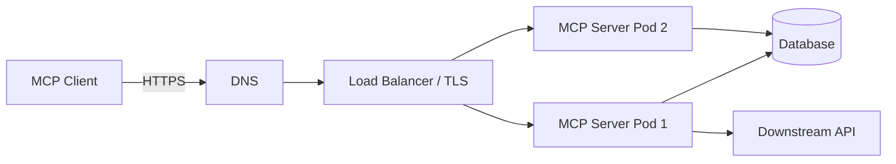
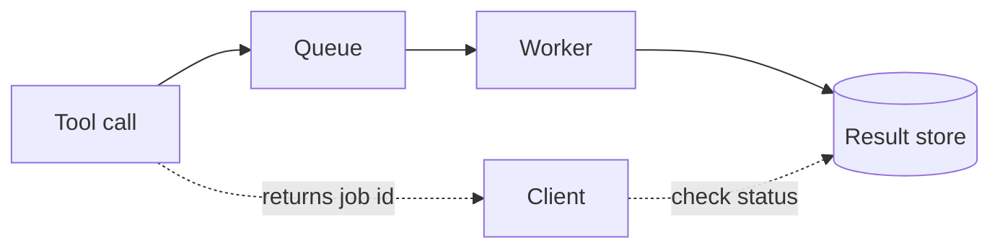

# Chapter 13 — Integrating Databases and External Services

Most MCP servers need to talk to other systems: a database, a REST API, files, or internal services. This chapter shows how to do it safely.

## 13.1 The golden rule: keep logic separate

Already in Chapter 6 we split `tasks/` (logic) from `mcp/` (protocol). Do the same for every integration. The MCP part should not know *how* you call an API. The integration part should not know about MCP.

```
src/
├── integrations/
│   ├── shippingApi.ts   # talks to an external API
│   └── storage.ts       # talks to object storage
├── tasks/               # DB logic
└── mcp/                 # MCP glue
```

## 13.2 Databases (SQLite / PostgreSQL)

### Connection pooling
A **pool** is a set of ready database connections the server reuses. Making a new connection each time is slow. A pool keeps a few open and shares them.

- SQLite (our demo): one file connection is fine for a local server.
- PostgreSQL (production): use a pool.

```ts
// src/integrations/pgPool.ts
// A PostgreSQL connection pool example.

import { Pool } from "pg";

export function createPool(connectionString: string): Pool {
  return new Pool({
    connectionString,
    max: 10,                     // max connections
    idleTimeoutMillis: 30000,    // close idle ones
    connectionTimeoutMillis: 5000, // give up connecting after 5s
  });
}
```

### Rules for DB access
- Use **parameters**, never string SQL (stops injection — Chapter 11).
- Set **timeouts** so a slow query does not hang forever.
- **Close** or return connections in `finally`.
- Filter by **tenant** in every query.
- Return **small** results (use `LIMIT`).

## 13.3 Calling an external REST API safely

Here is a complete, safe tool that calls an external shipping API. It shows all the pieces: config, auth, validation, timeout, retry, SSRF check, and small output.

```ts
// src/integrations/shippingApi.ts
// Talks to an external shipping API. No MCP code here.

import { z } from "zod";
import { withTimeout } from "../utils/timeout.js";
import { retry } from "../utils/retry.js";

// What we expect back from the API. We validate it.
const ApiResponse = z.object({
  status: z.string(),
  location: z.string().optional(),
  estimatedDelivery: z.string().optional(),
});

export interface Tracking {
  status: string;
  location?: string;
  estimatedDelivery?: string;
}

export class ShippingApi {
  constructor(
    private baseUrl: string,
    private apiKey: string,
  ) {}

  async track(trackingId: string, signal?: AbortSignal): Promise<Tracking> {
    // 1. Validate input shape (only safe characters).
    if (!/^[A-Za-z0-9-]{1,40}$/.test(trackingId)) {
      throw new Error("Invalid tracking ID");
    }

    // 2. Build the URL safely. Encode the input.
    const url = `${this.baseUrl}/track/${encodeURIComponent(trackingId)}`;

    // 3. Call with timeout and retry (read-only = safe to retry).
    const raw = await retry(
      () =>
        withTimeout(
          fetch(url, {
            headers: { Authorization: `Bearer ${this.apiKey}` },
            signal,
          }).then(async (res) => {
            if (!res.ok) {
              throw new Error(`API returned ${res.status}`);
            }
            return res.json();
          }),
          5000,
          "shipping-api",
        ),
      {
        maxAttempts: 3,
        baseDelayMs: 300,
        maxDelayMs: 2000,
        // Only retry on network/5xx style errors.
        shouldRetry: (err) => String(err).includes("API returned 5"),
      },
    );

    // 4. Validate the response. Do not trust the API blindly.
    const data = ApiResponse.parse(raw);

    // 5. Return only what we need (data minimization).
    return {
      status: data.status,
      location: data.location,
      estimatedDelivery: data.estimatedDelivery,
    };
  }
}
```

The MCP tool just calls this:

```ts
// In src/mcp/tools.ts (add this tool)
server.registerTool(
  "track_shipment",
  {
    description: "Track a shipment by its tracking ID.",
    inputSchema: z.object({ trackingId: z.string() }).shape,
  },
  safe(logger, async (args) => {
    const { trackingId } = z.object({ trackingId: z.string() }).parse(args);
    const result = await shippingApi.track(trackingId);
    return textResult(
      `Status: ${result.status}` +
        (result.location ? `, Location: ${result.location}` : "") +
        (result.estimatedDelivery ? `, ETA: ${result.estimatedDelivery}` : ""),
    );
  }),
);
```

## 13.4 Do NOT become an open proxy

A big danger: a tool that fetches *any* URL or calls *any* internal service turns your MCP server into an open door to your whole network. An attacker (via prompt injection) could reach internal systems.

**Fix:**
- Expose **specific** tools (`track_shipment`), not a general `http_get(url)`.
- If you must fetch URLs, use an **allow-list** of domains (Chapter 11 SSRF).
- Never let tool input choose which internal service to call.

```ts
// BAD: open proxy. Do not do this.
server.registerTool("http_get", {...}, async (args) => {
  return fetch(args.url); // attacker can hit anything
});

// GOOD: specific, limited tool.
server.registerTool("track_shipment", {...}, ...);
```

## 13.5 File system access

- Use a fixed base folder.
- Check paths for traversal (Chapter 11).
- Limit file sizes you read.
- Do not expose the whole disk.

## 13.6 Object storage / search / microservices

Same pattern for all:

| Step | What to do |
|------|-----------|
| Connection | Config from env; pool if needed |
| Auth | Separate credentials (not the user's token) |
| Input validation | Zod on every input |
| Authorization | Check the real user's permission |
| Timeouts | Always set them |
| Retry | Only if idempotent |
| Output limits | Return small, minimal data |
| Cleanup | Close connections in `finally` |
| Testing | Mock the external service (Chapter 14) |

## 13.7 Integration mistakes to avoid

| Mistake | Fix |
|---------|-----|
| General `http_get` tool | Specific tools + allow-list |
| Forwarding user token downstream | Separate service credentials |
| No timeout | Add timeouts |
| Returning huge payloads | Limit output |
| Trusting API responses | Validate with Zod |
| Secrets in code | Env vars + secret manager |

---

# Chapter 14 — Testing and Quality Assurance

Tests let you change code with confidence. Because our logic is separate from MCP, testing is easy.

## 14.1 Levels of testing

| Level | What it tests | Needs |
|-------|---------------|-------|
| Unit | One function (service) | Nothing external |
| Tool handler | A tool, with mocked service | Mocks |
| Integration | Client ↔ server over a transport | A running server |
| Contract | Tool schemas stay stable | Snapshot of schemas |
| Security | Auth, authz, injection | Test users/tokens |
| Load | Many calls at once | Load tool |

## 14.2 Unit tests (already done)

We tested `TaskService` in Chapter 6. That covers create, get, update, delete, search, stats, and the "not found" error.

## 14.3 Testing tool handlers without the protocol

Because handlers are plain functions, you can call them directly with mocked inputs.

```ts
// tests/tools.test.ts
import { describe, it, expect, vi } from "vitest";
import { safe, textResult } from "../src/mcp/errorHandling.js";
import { NotFoundError } from "../src/errors.js";

const logger = {
  debug: vi.fn(), info: vi.fn(), warn: vi.fn(), error: vi.fn(),
};

describe("safe() wrapper", () => {
  it("returns normal result on success", async () => {
    const handler = safe(logger, async () => textResult("ok"));
    const result = await handler({});
    expect(result.isError).toBe(false);
    expect(result.content[0].text).toBe("ok");
  });

  it("turns NotFoundError into an error result", async () => {
    const handler = safe(logger, async () => {
      throw new NotFoundError("Task 5 not found");
    });
    const result = await handler({});
    expect(result.isError).toBe(true);
    expect(result.content[0].text).toContain("not found");
  });

  it("hides unknown errors", async () => {
    const handler = safe(logger, async () => {
      throw new Error("secret connection string leaked");
    });
    const result = await handler({});
    expect(result.isError).toBe(true);
    // The secret must NOT appear in the result.
    expect(result.content[0].text).not.toContain("secret");
    expect(result.content[0].text).toBe("An internal error occurred.");
  });
});
```

## 14.4 Testing input validation

```ts
// tests/schemas.test.ts
import { describe, it, expect } from "vitest";
import { CreateTaskInput } from "../src/tasks/schemas.js";

describe("CreateTaskInput", () => {
  it("accepts valid input", () => {
    const r = CreateTaskInput.safeParse({ title: "Buy milk" });
    expect(r.success).toBe(true);
  });

  it("rejects missing title", () => {
    const r = CreateTaskInput.safeParse({});
    expect(r.success).toBe(false);
  });

  it("rejects wrong type", () => {
    const r = CreateTaskInput.safeParse({ title: 123 });
    expect(r.success).toBe(false);
  });

  it("rejects bad priority", () => {
    const r = CreateTaskInput.safeParse({ title: "x", priority: "urgent" });
    expect(r.success).toBe(false);
  });
});
```

## 14.5 Mocking external services

Never call the real API in tests. Mock `fetch`.

```ts
// tests/shipping.test.ts
import { describe, it, expect, vi, afterEach } from "vitest";
import { ShippingApi } from "../src/integrations/shippingApi.js";

describe("ShippingApi", () => {
  afterEach(() => vi.restoreAllMocks());

  it("returns tracking info", async () => {
    vi.stubGlobal("fetch", vi.fn(async () => ({
      ok: true,
      json: async () => ({ status: "In transit", location: "Berlin" }),
    })));

    const api = new ShippingApi("https://api.example.com", "key");
    const result = await api.track("ABC123");
    expect(result.status).toBe("In transit");
    expect(result.location).toBe("Berlin");
  });

  it("handles API errors", async () => {
    vi.stubGlobal("fetch", vi.fn(async () => ({
      ok: false,
      status: 404,
      json: async () => ({}),
    })));

    const api = new ShippingApi("https://api.example.com", "key");
    await expect(api.track("ABC123")).rejects.toThrow();
  });

  it("rejects bad tracking IDs", async () => {
    const api = new ShippingApi("https://api.example.com", "key");
    await expect(api.track("../../etc/passwd")).rejects.toThrow("Invalid");
  });
});
```

## 14.6 The required test cases

Here is how each case maps to a test:

| Case | How to test |
|------|-------------|
| Valid input | `safeParse` succeeds; handler returns ok |
| Missing input | `safeParse` fails |
| Invalid types | `safeParse` fails |
| Unauthorized user | Call handler with a user who lacks permission → error |
| Database down | Mock DB to throw → handler returns safe error |
| API timeout | Mock fetch to delay → `withTimeout` rejects |
| Malformed response | Mock fetch bad JSON → Zod `.parse` fails |
| Duplicate request | Call idempotent action twice with same key → one effect |
| Large output | Check output is capped |
| Cancellation | Pass an aborted signal → call stops |
| Graceful shutdown | Call shutdown → DB closed, exit 0 |

## 14.7 Integration test (client ↔ server)

Start the real server as a child process and talk to it with the client SDK.

```ts
// tests/integration.test.ts
import { describe, it, expect, beforeAll, afterAll } from "vitest";
import { Client } from "@modelcontextprotocol/sdk/client/index.js";
import { StdioClientTransport } from "@modelcontextprotocol/sdk/client/stdio.js";

describe("MCP integration", () => {
  let client: Client;

  beforeAll(async () => {
    client = new Client({ name: "test", version: "1.0.0" });
    const transport = new StdioClientTransport({
      command: "node",
      args: ["build/index.js"],
      env: { DATABASE_PATH: ":memory:", LOG_LEVEL: "error" },
    });
    await client.connect(transport);
  });

  afterAll(async () => {
    await client.close();
  });

  it("lists tools", async () => {
    const result = await client.listTools();
    const names = result.tools.map((t) => t.name);
    expect(names).toContain("create_task");
  });

  it("creates and gets a task", async () => {
    const created = await client.callTool({
      name: "create_task",
      arguments: { title: "Test" },
    });
    expect(created.isError).toBeFalsy();
  });
});
```

> **[VERIFY]** that SQLite `:memory:` works per-process here; for STDIO integration, a temp file may be more reliable.

## 14.8 Failure injection

Deliberately break things in tests to check your error handling works. Examples: make the DB throw, make the API return 500, delay past the timeout, send an aborted signal. We did several above.

## 14.9 Load testing (idea)

Use a tool to send many tool calls at once and watch latency and errors. We cover scaling in Chapter 17. Do not claim exact numbers without measuring.

## 14.10 Testing checklist

- [ ] Unit tests for all service functions
- [ ] Validation tests (valid, missing, wrong type)
- [ ] Error-handling tests (hidden secrets!)
- [ ] Auth/authz tests
- [ ] External service mocked
- [ ] Timeout and cancellation tested
- [ ] Idempotency tested
- [ ] Integration test over STDIO
- [ ] Shutdown tested

---

# Chapter 15 — Logging, Monitoring, and Observability

In production you cannot "see" the server. Logs, metrics, and traces are your eyes.

## 15.1 Structured logs

Log in JSON, not plain text. JSON is easy for machines to search. We already do this in `logger.ts` (Chapter 6).

```json
{"time":"2025-01-01T10:00:00Z","level":"info","message":"tool called","extra":{"tool":"create_task","durationMs":12}}
```

## 15.2 Log levels

| Level | Use for |
|-------|---------|
| `debug` | Detailed dev info |
| `info` | Normal events (tool called) |
| `warn` | Something odd but handled |
| `error` | A real failure |

In production, use `info` or `warn` (not `debug`, to avoid noise and leaks).

## 15.3 Correlation IDs and trace IDs

A **correlation ID** is a unique ID for one request. Put it in every log line for that request. Then you can find all logs for one user action.

A **trace ID** links logs across systems (client → server → DB → API).

```ts
// Attach a request ID to logs for one tool call.
import { randomUUID } from "node:crypto";

function withRequestId<T>(logger: Logger, fn: (reqId: string) => T): T {
  const reqId = randomUUID();
  logger.info("request start", { reqId });
  return fn(reqId);
}
```

## 15.4 Never log secrets

This is critical. Do not log:
- Access tokens, passwords, API keys.
- Personal data (names, emails) unless needed and allowed.
- Full tool arguments if they may contain sensitive info.

Use the `redact()` function from Chapter 11.

```ts
logger.info("tool called", {
  tool: "create_task",
  args: redact(args as Record<string, unknown>),
});
```

## 15.5 Metrics to track

| Metric | Why |
|--------|-----|
| Tool calls per minute | Load |
| Tool latency (p50, p95, p99) | Speed |
| Tool error rate | Health |
| Timeout rate | Downstream problems |
| Auth failures | Possible attack |
| Downstream API failures | Dependency health |
| Active connections | Capacity |
| Cancellations | User behavior |

> p95 means "95% of calls are faster than this". Percentiles show the slow tail, which averages hide.

## 15.6 Distributed tracing (OpenTelemetry)

For complex systems, use **OpenTelemetry** to trace a request across all services. Each step becomes a "span". You can see where time was spent.

```ts
// Idea (pseudocode): wrap a tool call in a span.
// const span = tracer.startSpan("tool.create_task");
// try { ... } finally { span.end(); }
```

**[VERIFY]** whether the MCP SDK has built-in tracing hooks; often you add OpenTelemetry yourself. **[ENG]**

## 15.7 Health and readiness checks

For HTTP servers:
- **Liveness** (`/healthz`): is the process alive? (Simple: return 200.)
- **Readiness** (`/readyz`): can it serve traffic? (Check DB connection.)

```ts
// Example health endpoints (HTTP server).
app.get("/healthz", (_req, res) => res.status(200).send("ok"));
app.get("/readyz", async (_req, res) => {
  try {
    await db.query("SELECT 1"); // can we reach the DB?
    res.status(200).send("ready");
  } catch {
    res.status(503).send("not ready");
  }
});
```

## 15.8 Audit trails

For sensitive actions (delete, payment, access to private data), log **who did what, when**. Keep these logs safe and separate. They help after an incident.

```json
{"audit":true,"user":"alice","action":"delete_task","taskId":5,"time":"..."}
```

## 15.9 Alerting

Set alerts for: high error rate, high latency, many auth failures, downstream API down. Alert a human when something needs attention. Do not alert on every small thing (alert fatigue).

## 15.10 Tracing a full request (example)

1. Client sends `create_task` with correlation ID `abc`.
2. Server logs `request start {reqId: abc}`.
3. Server logs the DB insert time.
4. Server logs `request done {reqId: abc, durationMs: 12}`.
5. If it calls an API, that span is linked by trace ID.

Now, if a user says "it was slow at 10am", you search for their reqId/trace and see exactly where time went.

## 15.11 Observability checklist

- [ ] Structured JSON logs
- [ ] Correct log level per environment
- [ ] Correlation ID per request
- [ ] Secrets redacted
- [ ] Key metrics exported
- [ ] Health and readiness endpoints (HTTP)
- [ ] Audit log for sensitive actions
- [ ] Alerts for errors and latency

---

# Chapter 16 — Deploying MCP Servers to Production

Now we deploy. First, understand the big difference between the two transports.

## 16.1 STDIO vs HTTP deployment

| | STDIO server | HTTP server |
|-|--------------|-------------|
| Runs where | On the user's machine, as a child of the host | On a server, in the cloud |
| Deployed like | Shipped with the app / installed | A web service (Docker, K8s) |
| Network | None | Yes (secure it) |
| Scaling | One per user | Many instances |

**Important:** A STDIO server is **not** deployed like a web service. The host starts it locally. Do **not** try to expose STDIO over the network. For remote, shared use, use **HTTP**. **[SPEC]**

## 16.2 Adding an HTTP entry point

We already have `src/index.ts` for STDIO. For remote, add a second entry point for HTTP. The server logic (`buildServer`) stays the same.

> **[SDK/VERIFY]** The exact HTTP transport class (`StreamableHTTPServerTransport`) and how you wire it to an HTTP framework depends on the SDK version. Check current docs. The shape below shows the idea.

```ts
// src/http.ts
// HTTP entry point using Streamable HTTP transport.
// The server LOGIC is the same; only the transport changes.

import express from "express";
import { StreamableHTTPServerTransport } from "@modelcontextprotocol/sdk/server/streamableHttp.js";
import { loadConfig } from "./config.js";
import { createLogger } from "./logger.js";
import { openDatabase } from "./db.js";
import { TaskService } from "./tasks/service.js";
import { buildServer } from "./mcp/server.js";

async function main() {
  const config = loadConfig();
  const logger = createLogger(config.logLevel);
  const db = openDatabase(config.databasePath, logger);
  const service = new TaskService(db);

  const app = express();
  app.use(express.json({ limit: "1mb" })); // request size limit

  // Health checks for load balancers.
  app.get("/healthz", (_req, res) => res.status(200).send("ok"));
  app.get("/readyz", (_req, res) => {
    try {
      db.prepare("SELECT 1").get();
      res.status(200).send("ready");
    } catch {
      res.status(503).send("not ready");
    }
  });

  // The MCP endpoint.
  app.post("/mcp", async (req, res) => {
    // In a real setup: verify the bearer token here (Chapter 12),
    // then create a transport and connect a fresh server per request
    // (stateless) OR reuse a session (stateful). [VERIFY] the SDK pattern.
    const server = buildServer(config, service, logger);
    const transport = new StreamableHTTPServerTransport({
      sessionIdGenerator: undefined, // stateless example [VERIFY]
    });
    await server.connect(transport);
    await transport.handleRequest(req, res, req.body);
  });

  const serverHttp = app.listen(config.port, config.host, () => {
    logger.info("HTTP server listening", { host: config.host, port: config.port });
  });

  // Graceful shutdown.
  function shutdown() {
    logger.info("Shutting down HTTP server");
    serverHttp.close(() => {
      db.close();
      process.exit(0);
    });
  }
  process.on("SIGINT", shutdown);
  process.on("SIGTERM", shutdown);
}

main().catch((err) => {
  console.error("Fatal:", err);
  process.exit(1);
});
```

> This HTTP example is **illustrative of the pattern**. The exact `StreamableHTTPServerTransport` options (session handling, `handleRequest`) must match your SDK version. **[VERIFY]**

Add scripts:
```json
"scripts": {
  "start": "node build/index.js",
  "start:http": "node build/http.js"
}
```

## 16.3 Dockerfile

```dockerfile
# Dockerfile
# Build and run the MCP HTTP server.

# ---- Build stage ----
FROM node:20-slim AS build
WORKDIR /app
COPY package*.json ./
RUN npm ci
COPY tsconfig.json ./
COPY src ./src
RUN npm run build

# ---- Run stage ----
FROM node:20-slim AS run
WORKDIR /app
# Only install production dependencies.
COPY package*.json ./
RUN npm ci --omit=dev

# better-sqlite3 needs its built files.
COPY --from=build /app/build ./build
COPY --from=build /app/node_modules/better-sqlite3 ./node_modules/better-sqlite3

# Run as a non-root user for safety.
USER node

ENV NODE_ENV=production
ENV HOST=0.0.0.0
ENV PORT=3000
EXPOSE 3000

CMD ["node", "build/http.js"]
```

> **Note:** `better-sqlite3` compiles native code. In production you often use PostgreSQL instead. If you keep SQLite, make sure the native build is present (as above) or rebuild in the run stage. **[VERIFY]**

## 16.4 .dockerignore

```
node_modules
build
*.db
.env
.git
tests
```

## 16.5 Docker Compose (for local testing with a DB)

```yaml
# docker-compose.yml
# Runs the MCP server with a Postgres DB for integration testing.

services:
  db:
    image: postgres:16
    environment:
      POSTGRES_PASSWORD: devpassword   # dev only, not real secret
      POSTGRES_DB: tasks
    ports:
      - "5432:5432"

  mcp:
    build: .
    environment:
      DATABASE_URL: postgres://postgres:devpassword@db:5432/tasks
      LOG_LEVEL: info
      HOST: 0.0.0.0
      PORT: "3000"
    ports:
      - "3000:3000"
    depends_on:
      - db
```

## 16.6 Production architecture (HTTP)



- TLS ends at the load balancer.
- Many server pods (stateless) share one database.
- Health checks tell the balancer which pods are ready.

## 16.7 Reverse proxy (keep streaming working)

From Chapter 4: **turn off response buffering** for the MCP path, or SSE streaming breaks. Set long read timeouts. Preserve `Authorization` and session headers. (See the nginx snippet in Chapter 4.)

## 16.8 Kubernetes manifests

### Deployment
```yaml
# k8s/deployment.yaml
apiVersion: apps/v1
kind: Deployment
metadata:
  name: mcp-task-server
spec:
  replicas: 2
  selector:
    matchLabels:
      app: mcp-task-server
  template:
    metadata:
      labels:
        app: mcp-task-server
    spec:
      securityContext:
        runAsNonRoot: true
        runAsUser: 1000
      containers:
        - name: mcp
          image: your-registry/mcp-task-server:1.0.0
          ports:
            - containerPort: 3000
          envFrom:
            - configMapRef:
                name: mcp-config
          env:
            - name: DATABASE_URL
              valueFrom:
                secretKeyRef:
                  name: mcp-secrets
                  key: database-url
          resources:
            requests:
              cpu: "100m"
              memory: "128Mi"
            limits:
              cpu: "500m"
              memory: "256Mi"
          livenessProbe:
            httpGet:
              path: /healthz
              port: 3000
            initialDelaySeconds: 5
            periodSeconds: 10
          readinessProbe:
            httpGet:
              path: /readyz
              port: 3000
            initialDelaySeconds: 5
            periodSeconds: 10
          securityContext:
            allowPrivilegeEscalation: false
            readOnlyRootFilesystem: true
      terminationGracePeriodSeconds: 30
```

### Service
```yaml
# k8s/service.yaml
apiVersion: v1
kind: Service
metadata:
  name: mcp-task-server
spec:
  selector:
    app: mcp-task-server
  ports:
    - port: 80
      targetPort: 3000
```

### ConfigMap
```yaml
# k8s/configmap.yaml
apiVersion: v1
kind: ConfigMap
metadata:
  name: mcp-config
data:
  LOG_LEVEL: "info"
  HOST: "0.0.0.0"
  PORT: "3000"
```

### Secret (reference only — do not commit real values)
```yaml
# k8s/secret.yaml  (example shape only!)
apiVersion: v1
kind: Secret
metadata:
  name: mcp-secrets
type: Opaque
stringData:
  database-url: "postgres://user:CHANGE_ME@db:5432/tasks"
```

> In real life, create secrets with a secret manager or `kubectl create secret`, not committed YAML. **[ENG]**

## 16.9 Deployment best practices

- **Graceful shutdown:** handle `SIGTERM`, close connections (we do).
- **Rolling deploys:** replace pods slowly so there is no downtime.
- **Rollbacks:** keep the old image so you can go back fast.
- **Version compatibility:** test client/server protocol versions before deploy. **[VERIFY]**
- **Backups:** back up the database; test restoring it.
- **Secrets:** use a secret manager, never git.

## 16.10 Deployment mistakes

| Mistake | Fix |
|---------|-----|
| Exposing STDIO over network | Use HTTP transport for remote |
| Proxy buffers SSE | Turn off buffering |
| Running as root | Use non-root user |
| No health checks | Add liveness/readiness |
| Secrets in image/git | Secret manager |
| No resource limits | Set requests/limits |

---

# Chapter 17 — Production Scaling and Reliability

What happens when many users hit the server at once? This chapter prepares you.

## 17.1 Concurrency basics

MCP allows many requests at the same time (Chapter 3). Node.js handles many requests on one thread using async I/O. But:
- CPU-heavy work blocks the thread. Move it to a worker or a background job.
- Shared state must be safe under concurrency.

## 17.2 Connection pools and DB limits

A database has a **max connection limit**. If every request opens its own connection, you hit the limit and requests fail.

**Fix:** use a pool (Chapter 13) with a sensible `max`. Many requests share a few connections. If all are busy, new requests wait a little (this is **backpressure** — slowing down on purpose instead of crashing).

## 17.3 Rate limiting and fairness

Stop one user from using everything. Limit calls per user per minute. This keeps the server fair for everyone.

```ts
// Simple per-user rate limit (in memory; use Redis in production).
const hits = new Map<string, { count: number; reset: number }>();

function allow(userId: string, limit: number, windowMs: number): boolean {
  const now = Date.now();
  const entry = hits.get(userId);
  if (!entry || entry.reset < now) {
    hits.set(userId, { count: 1, reset: now + windowMs });
    return true;
  }
  if (entry.count >= limit) return false;
  entry.count++;
  return true;
}
```

## 17.4 Tenant isolation under load

One noisy tenant should not slow down others. Apply per-tenant rate limits and quotas. Watch per-tenant metrics.

## 17.5 Long-running tasks: use a queue

If a tool takes a long time (minutes), do **not** keep the request open. Instead:
1. The tool starts a background job and returns a job ID right away.
2. A separate worker does the work.
3. The client checks status later, or gets notified.



Why? Open connections cost resources. Queues handle spikes and survive restarts. **[ENG]**

## 17.6 Streaming for progress

For medium-length work, use **progress notifications** (Chapter 3) over the stream so the user sees it is working. For very long work, use a queue (above).

## 17.7 Horizontal scaling (stateless)

To handle more load, run **more copies** of the server behind a load balancer. This works best when the server is **stateless** (keeps no per-connection memory). Push state to the database or Redis.

- **Stateless:** any copy can handle any request. Easy to scale.
- **Stateful:** needs session affinity (same user → same copy). Harder.

**Prefer stateless.** (Chapter 4.)

## 17.8 Caching

Cache results that do not change often (like stats, or reference data). This cuts load on the database and speeds up responses. Set a short expiry so data stays fresh enough.

## 17.9 Overload protection

When overloaded, it is better to **reject some requests quickly** than to slow down and crash everything. Use:
- Rate limits.
- A max number of in-flight requests.
- Circuit breakers for slow downstreams (Chapter 10).

## 17.10 What happens when… (scenarios)

| Scenario | What happens | What to do |
|----------|-------------|-----------|
| Hundreds of users at once | Threads/pool fill up | Scale out; rate limit; pool |
| Downstream API slow | Requests pile up | Timeouts + circuit breaker |
| DB connection limit hit | New queries fail | Pool with max; backpressure |
| One tool gets huge input | Memory/CPU spike | Input size limits; validation |
| A server restarts mid-request | That request fails | Client retries (if idempotent) |
| Client disconnects mid-task | Work wasted | Cancellation; use queues |

## 17.11 Memory leaks and CPU

- **Memory leak:** memory grows and never frees. Watch memory metrics. Common cause: a `Map` that keeps growing (like our idempotency store without cleanup). Add expiry/cleanup.
- **CPU-heavy work:** move to worker threads or background jobs so it does not block other requests.

## 17.12 Capacity planning (idea)

1. Measure one instance: how many calls per second before latency rises?
2. Decide your target load.
3. Add instances to cover it, plus spare room.
4. Load test to confirm.

**Do not guess exact numbers.** Measure. Every server and workload is different. **[ENG]**

## 17.13 Scaling checklist

- [ ] Stateless server (or affinity planned)
- [ ] Connection pool with a max
- [ ] Rate limiting per user/tenant
- [ ] Timeouts on all external calls
- [ ] Circuit breakers for downstreams
- [ ] Long tasks moved to a queue
- [ ] Caching where safe
- [ ] Memory and CPU metrics watched
- [ ] Load tested before launch
- [ ] Overload rejects fast, does not crash

---