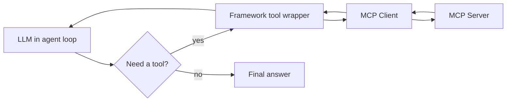
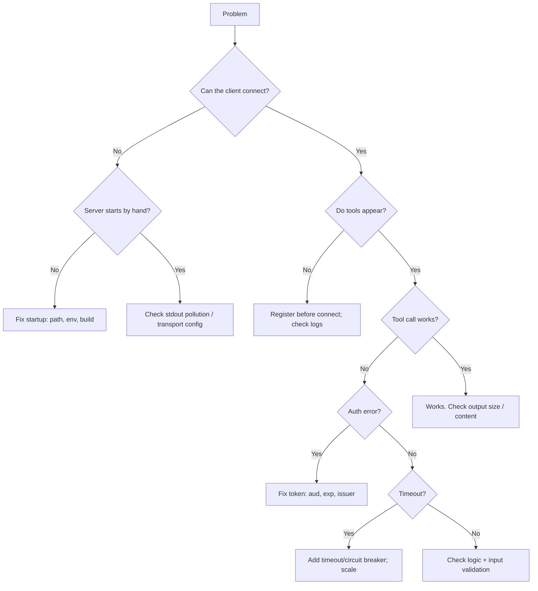

# Chapter 18 — MCP and AI Agent Frameworks

MCP gives you tools, resources, and prompts. An **agent framework** decides *when* and *how* to use them. They work together.

## 18.1 The clear split

| MCP does | The framework does |
|----------|--------------------|
| Standard way to expose tools | Decide which tool to call |
| Carry messages (protocol) | Plan multi-step actions |
| List capabilities | Loop until the task is done |
| Return results | Keep memory and state |

**Short version:** MCP = the connection. The framework = the brain and the plan. **[SPEC/ENG]**

## 18.2 How an agent uses MCP tools

1. The framework starts an MCP client.
2. It calls `tools/list` to learn the tools.
3. It turns MCP tools into the framework's own tool objects (a thin wrapper).
4. The LLM, inside the framework's loop, picks a tool.
5. The framework calls the tool through the MCP client.
6. The result goes back into the loop.
7. The loop repeats until the task is done.



## 18.3 Wrapping MCP tools (idea)

Most frameworks have a helper that loads MCP tools for you. If not, you write a small wrapper that:
- Reads the MCP tool list.
- Makes a framework tool for each one.
- When called, forwards to the MCP client.

```ts
// Conceptual wrapper: turn MCP tools into framework tools.
async function loadMcpToolsAsFrameworkTools(mcp: TaskMcpClient) {
  const tools = await mcp.listTools();
  return tools.map((t) => ({
    name: t.name,
    description: t.description,
    schema: t.inputSchema,
    // The framework calls this when the LLM picks the tool.
    run: (args: Record<string, unknown>) => mcp.callTool(t.name, args),
  }));
}
```

> **[VERIFY]** LangChain and LangGraph have official MCP adapters (for example, an "MCP adapters" package). Check current docs for the exact package name and usage. The idea above matches what those adapters do under the hood.

## 18.4 Multiple MCP servers in one agent

An agent can use many servers at once. Merge all their tools. Watch for:
- **Name collisions:** add a prefix (`tasks.search`, `docs.search`).
- **Too many tools:** filter to the ones this task needs, to save context.
- **Permissions:** not every tool should be available to every user.

## 18.5 Tool execution loop and planning

The framework runs a loop: think → call tool → read result → think again. This continues until the LLM decides it is finished. MCP is only used for the "call tool" step. The planning and stopping logic belongs to the framework.

## 18.6 Human-in-the-loop

For risky actions (delete, pay, send email), the framework should **pause and ask a human** before calling the tool. MCP tool annotations (like `destructiveHint`, Chapter 5) can tell the framework which tools need approval. But remember: annotations are hints, not security. Real checks still live in the server. **[ENG]**

## 18.7 State and memory

MCP does not store conversation memory. The framework does. If a tool needs context from earlier, the framework passes it in the arguments. Keep MCP servers mostly stateless so they scale (Chapter 17).

## 18.8 Vendor-neutral design

Keep your LLM provider behind an adapter (Chapter 7). Keep MCP tools separate from framework code. Then you can switch the model or the framework without rewriting your servers. This is a big benefit of MCP. **[ENG]**

## 18.9 Framework integration mistakes

| Mistake | Fix |
|---------|-----|
| Expecting MCP to plan | The framework/LLM plans |
| No tool prefixing | Collisions; add prefixes |
| Loading all tools always | Filter per task |
| Trusting annotations for security | Enforce in the server |
| Memory inside the MCP server | Keep memory in the framework |

---

# Chapter 19 — Common Mistakes and Troubleshooting

A problem-by-problem guide. For each: symptoms, causes, how to check, how to fix, how to prevent.

## 19.1 Server starts but client cannot connect
- **Symptoms:** client shows "no connection" or timeout.
- **Causes:** wrong command/path; server crashes at start; wrong transport.
- **Check:** run the server by hand; read stderr; check the client config path.
- **Fix:** use full paths; fix the startup error.
- **Prevent:** test with the Inspector first.

## 19.2 STDIO connection fails
- **Symptoms:** client gets no handshake.
- **Causes:** binary not found; immediate exit; env missing.
- **Check:** `node build/index.js` by hand; echo env vars.
- **Fix:** correct `command`/`args`/`env` in client config.
- **Prevent:** validate config at startup (fail fast).

## 19.3 Logs corrupt protocol output
- **Symptoms:** parse errors; garbage; desync.
- **Causes:** `console.log` to stdout; a library prints to stdout.
- **Check:** run by hand and watch stdout — only JSON should appear.
- **Fix:** use `console.error` or the MCP log channel; silence noisy libraries.
- **Prevent:** a rule: **nothing but MCP on stdout** (Chapter 4).

## 19.4 Tools do not appear
- **Symptoms:** `tools/list` is empty.
- **Causes:** tools registered after connect; a crash during registration; capability not advertised.
- **Check:** Inspector `tools/list`; server logs.
- **Fix:** register tools before `connect`; fix registration errors.
- **Prevent:** integration test that lists tools (Chapter 14).

## 19.5 Tool schemas are invalid
- **Symptoms:** client rejects the tool; model sends bad args.
- **Causes:** wrong Zod/JSON Schema; unsupported schema feature.
- **Check:** look at the generated schema in the Inspector.
- **Fix:** simplify the schema; match SDK support.
- **Prevent:** schema tests (Chapter 14).

## 19.6 Tool arguments are rejected
- **Symptoms:** "invalid input" every time.
- **Causes:** schema too strict; type mismatch; model sends strings for numbers.
- **Check:** log the raw args (redacted); test `safeParse`.
- **Fix:** coerce types where safe (e.g. `z.coerce.number()`); relax where fine.
- **Prevent:** clear descriptions so the model sends the right types.

## 19.7 A tool returns an unexpected result
- **Symptoms:** wrong or empty output.
- **Causes:** logic bug; wrong query; untrusted API data.
- **Check:** unit test the service with that input.
- **Fix:** fix the logic; validate API responses.
- **Prevent:** more unit tests.

## 19.8 Client and server disagree on capabilities
- **Symptoms:** a feature does not work (e.g. subscriptions).
- **Causes:** capability not advertised; version mismatch.
- **Check:** look at the `initialize` result.
- **Fix:** advertise the capability; update SDK.
- **Prevent:** check capabilities in tests.

## 19.9 HTTP transport fails behind a proxy
- **Symptoms:** streaming hangs; timeouts; cut connections.
- **Causes:** proxy buffering on; short timeouts; dropped headers.
- **Check:** curl the endpoint directly vs through the proxy.
- **Fix:** turn off buffering; raise timeouts; preserve headers (Chapter 4).
- **Prevent:** test the full proxy path before launch.

## 19.10 Authentication fails
- **Symptoms:** 401 for everyone.
- **Causes:** wrong issuer/audience; clock skew; wrong JWKS URL.
- **Check:** decode the token; compare `aud`/`iss`.
- **Fix:** set correct issuer/audience; fix JWKS URL.
- **Prevent:** auth tests with real test tokens.

## 19.11 Tokens are rejected
- **Symptoms:** valid-looking tokens fail.
- **Causes:** expired; wrong audience; wrong signing key.
- **Check:** check `exp` and `aud`; verify signature.
- **Fix:** refresh tokens; fix audience; rotate keys correctly.
- **Prevent:** short expiry + refresh; audience check (Chapter 12).

## 19.12 Sessions behave unexpectedly
- **Symptoms:** state lost; wrong user's data.
- **Causes:** no session affinity on a stateful server; session mix-up.
- **Check:** which pod served the request; session ID logs.
- **Fix:** go stateless, or add affinity (Chapter 17).
- **Prevent:** prefer stateless servers.

## 19.13 Requests time out
- **Symptoms:** slow then error.
- **Causes:** slow DB/API; no timeout; overload.
- **Check:** latency metrics; downstream health.
- **Fix:** add timeouts; add circuit breaker; scale.
- **Prevent:** set timeouts everywhere (Chapter 10).

## 19.14 Duplicate operations occur
- **Symptoms:** two tasks created; two emails sent.
- **Causes:** retry on a non-idempotent action.
- **Check:** request logs with the same key.
- **Fix:** add idempotency keys; stop retrying non-idempotent ops.
- **Prevent:** mark idempotent vs not; design keys (Chapter 10).

## 19.15 Server crashes under concurrent load
- **Symptoms:** restarts under load.
- **Causes:** unhandled errors; DB limit hit; memory leak.
- **Check:** crash logs; memory metrics; pool stats.
- **Fix:** wrap handlers; pool with max; fix leaks.
- **Prevent:** load test; overload protection (Chapter 17).

## 19.16 Secrets appear in logs
- **Symptoms:** tokens/keys in log files.
- **Causes:** logging full args/errors.
- **Check:** search logs for "token", "password".
- **Fix:** add redaction; log safe fields only.
- **Prevent:** redact by default (Chapter 11/15).

## 19.17 Works locally but fails in production
- **Symptoms:** fine on laptop, broken in cloud.
- **Causes:** missing env/secrets; different paths; proxy; permissions.
- **Check:** compare config; read production logs.
- **Fix:** set env/secrets; fix paths; fix proxy.
- **Prevent:** config validation; staging that matches prod.

## 19.18 SDK upgrade breaks compatibility
- **Symptoms:** build errors; methods missing; behavior changed.
- **Causes:** API changed between versions.
- **Check:** release notes/changelog; types.
- **Fix:** update to the new API; test.
- **Prevent:** pin versions; read changelogs; test before upgrading. **[VERIFY]**

## 19.19 Debugging decision tree



---

# Chapter 20 — Complete Reference Project

This brings everything together. It is the full `mcp-task-server` with both transports.

## 20.1 Final structure

```
mcp-task-server/
├── package.json
├── tsconfig.json
├── .env.example
├── .gitignore
├── Dockerfile
├── .dockerignore
├── docker-compose.yml
├── src/
│   ├── config.ts            # REQUIRED  settings + validation
│   ├── logger.ts            # REQUIRED  safe logging (stderr)
│   ├── db.ts                # REQUIRED  SQLite setup
│   ├── errors.ts            # REQUIRED  error types
│   ├── shutdown.ts          # REQUIRED  graceful shutdown
│   ├── utils/
│   │   ├── timeout.ts       # REQUIRED  timeouts
│   │   ├── retry.ts         # OPTIONAL  retries
│   │   ├── circuitBreaker.ts# OPTIONAL  circuit breaker
│   │   └── idempotency.ts   # OPTIONAL  idempotency keys
│   ├── tasks/
│   │   ├── schemas.ts       # REQUIRED  Zod shapes
│   │   └── service.ts       # REQUIRED  task logic (no MCP)
│   ├── integrations/
│   │   └── shippingApi.ts   # OPTIONAL  external API example
│   ├── auth/
│   │   └── verifyToken.ts   # OPTIONAL  for HTTP auth
│   ├── mcp/
│   │   ├── server.ts        # REQUIRED  builds MCP server
│   │   ├── tools.ts         # REQUIRED  tool handlers
│   │   ├── resources.ts     # REQUIRED  resource handlers
│   │   ├── prompts.ts       # REQUIRED  prompt handlers
│   │   └── errorHandling.ts # REQUIRED  safe() wrapper
│   ├── index.ts             # REQUIRED  STDIO entry point
│   └── http.ts              # OPTIONAL  HTTP entry point
├── tests/
│   ├── service.test.ts      # REQUIRED
│   ├── schemas.test.ts      # REQUIRED
│   ├── tools.test.ts        # REQUIRED
│   ├── shipping.test.ts     # OPTIONAL
│   └── integration.test.ts  # REQUIRED
└── k8s/                     # OPTIONAL  production deploy
    ├── deployment.yaml
    ├── service.yaml
    ├── configmap.yaml
    └── secret.yaml
```

## 20.2 Required vs optional

| Required (core) | Optional (add when needed) |
|-----------------|----------------------------|
| config, logger, db, errors, shutdown | retry, circuit breaker, idempotency |
| tasks (schemas, service) | integrations (shipping API) |
| mcp (server, tools, resources, prompts, errorHandling) | auth (verifyToken) |
| index.ts (STDIO) | http.ts (HTTP) |
| core tests | integration/external tests |
| — | Docker, Compose, Kubernetes |

## 20.3 Two entry points, two transports

| Entry point | Transport | Command | Use |
|-------------|-----------|---------|-----|
| `src/index.ts` | STDIO | `npm start` | Local, desktop, dev |
| `src/http.ts` | Streamable HTTP | `npm run start:http` | Remote, cloud, multi-user |

Both call the **same** `buildServer()`. Only the transport differs. This is why the split in Chapter 6 matters: logic is shared, transport is swapped.

## 20.4 How to run the whole project

```bash
# 1. Install and build
npm install
npm run build

# 2. Run tests
npm test

# 3. Run locally over STDIO
npm start

# 4. Inspect it
npx @modelcontextprotocol/inspector node build/index.js

# 5. Run over HTTP (optional)
npm run start:http

# 6. Run in Docker (optional)
docker build -t mcp-task-server .
docker run -p 3000:3000 -e HOST=0.0.0.0 mcp-task-server

# 7. Local stack with a database (optional)
docker compose up
```

## 20.5 What this project demonstrates

- ✅ Correct MCP server init and lifecycle
- ✅ STDIO for local, HTTP for remote
- ✅ Tools, a resource, and a prompt
- ✅ Database integration (SQLite; swap for Postgres in prod)
- ✅ Zod validation (never trust input)
- ✅ Central error handling (safe messages)
- ✅ Auth/authz hooks (HTTP)
- ✅ Safe logging (stderr, redaction)
- ✅ Config validation at startup
- ✅ Graceful shutdown
- ✅ Automated tests
- ✅ Docker + Kubernetes
- ✅ A sample client (Chapter 7)

All file names, imports, scripts, and versions match across the guide.

---

# Chapter 21 — Learning Roadmap and Practical Exercises

Learn step by step. Each level builds on the last.

## Level 1 — Fundamentals
**Goal:** understand the parts.
- Learn host vs client vs server.
- Learn JSON-RPC (request, response, notification).
- Learn tools vs resources vs prompts.
- Watch a real MCP connection with the Inspector.
**Outcome:** you can explain each part in simple words.
**Common mistake:** mixing up client and server.
**Done when:** you can draw the architecture diagram from memory.

## Level 2 — Implementation
**Goal:** build a server.
- Make a basic STDIO server with one tool.
- Add Zod validation.
- Add a SQLite database.
- Add a resource and a prompt.
- Build a simple client.
**Outcome:** a working task server and a client.
**Common mistake:** `console.log` breaking STDIO.
**Done when:** the Inspector lists and runs your tools.

## Level 3 — Reliability
**Goal:** make it robust.
- Add central error handling.
- Add timeouts and cancellation.
- Add tests.
- Add structured logs and metrics.
**Outcome:** the server handles failures well.
**Common mistake:** leaking raw errors to the model.
**Done when:** failure tests pass and secrets never leak.

## Level 4 — Security
**Goal:** make it safe.
- Add authentication (HTTP).
- Add authorization in every tool.
- Add tenant isolation.
- Defend against prompt injection and unsafe tools.
- Do a security review with the checklist.
**Outcome:** a secure multi-user server.
**Common mistake:** auth only in the prompt.
**Done when:** the security checklist (Chapter 11) is all ticked.

## Level 5 — Production
**Goal:** deploy and scale.
- Containerize with Docker.
- Deploy the HTTP server.
- Configure TLS and a reverse proxy.
- Add monitoring and alerts.
- Load test and test recovery.
**Outcome:** a running production server.
**Common mistake:** proxy buffering breaks streaming.
**Done when:** it survives a load test and a pod restart.

## 15+ Exercises

**Beginner**
1. Run the Inspector against the example server; call every tool.
2. Add a new tool `count_tasks` that returns just the total.
3. Add a new priority value `urgent` and update the schema.
4. Make `list_tasks` sort by priority.
5. Add a resource `task://recent` that returns the 5 newest tasks.

**Intermediate**
6. Write a unit test for the new `count_tasks` tool.
7. Add a timeout to a tool and test that it fires.
8. Add an idempotency key to `create_task` and prove no duplicates.
9. Add a second prompt `summarize_tasks`.
10. Add a `search` prefix so two servers don't collide.

**Advanced**
11. Add the HTTP entry point and run it with curl.
12. Add token verification and reject requests without a valid token.
13. Add per-user authorization so users only see their own tasks.
14. Add tenant isolation and prove tenant A can't see tenant B's data.
15. Containerize it and run it behind nginx with streaming working.
16. Load test it and find where latency rises; add a connection pool.
17. Add a circuit breaker to the shipping API tool and test it opens.

## Solution outlines (hard ones)

**#8 Idempotency:** add an `idempotencyKey` argument to `create_task`. Use `IdempotencyStore.run(key, ...)` (Chapter 10). In a test, call twice with the same key and assert only one row exists.

**#12 Token verify:** in `http.ts`, read the `Authorization` header, call `verifyToken` (Chapter 12), and return 401 if it fails. Pass the `AuthContext` into tool handlers.

**#13/#14 Authz + tenancy:** add `ownerId`/`tenantId` columns. In every query, filter by `tenantId`. In handlers, compare the task's owner to `auth.userId`. Test with two fake users/tenants.

**#15 Docker + nginx:** use the Dockerfile (Chapter 16) and the nginx config with `proxy_buffering off`. Prove streaming works by watching progress notifications arrive one by one.

**#17 Circuit breaker:** wrap the shipping API call in `CircuitBreaker.call` (Chapter 10). In a test, force 5 failures, then assert the next call fails fast with "Circuit is open".

---

# Chapter 22 — Glossary and Quick Reference

## 22.1 Glossary

| Term | Simple meaning |
|------|----------------|
| MCP | A standard way to connect AI apps to tools and data |
| Host | The AI app the user talks to |
| Client | The part inside the host that talks to one server |
| Server | The program that offers tools/resources/prompts |
| Tool | An action the model can call |
| Resource | Data the app loads into the model's context |
| Prompt | A reusable template the user triggers |
| Transport | The pipe that carries messages (STDIO or HTTP) |
| STDIO | Local transport using stdin/stdout |
| Streamable HTTP | Remote transport over HTTP (with SSE streaming) |
| SSE | Server-Sent Events; a way to stream messages |
| JSON-RPC | The message format MCP uses |
| Request/Response | A message that asks and one that answers |
| Notification | A one-way message with no reply |
| Capability negotiation | Both sides share what they support |
| Initialization | The handshake at the start |
| Sampling | Server asks the host's LLM to generate text |
| Roots | Client tells server which folders/URIs it may use |
| Progress | Updates during a long operation |
| Idempotent | Doing it twice = doing it once |
| Idempotency key | A key so retries don't repeat an action |
| Circuit breaker | Stops calling a broken service for a while |
| OAuth | A way to give limited access using tokens |
| Access token | A temporary key proving who/what is allowed |
| Audience (`aud`) | Who a token is meant for |
| Scope | What a token is allowed to do |
| Prompt injection | Hidden instructions in content that trick the model |
| Tool poisoning | Bad tool descriptions used to manipulate the model |
| Confused deputy | Tricking a powerful server to act for an attacker |
| Stateless | Keeps no per-connection memory; easy to scale |
| Tenant isolation | Keeping each customer's data separate |

## 22.2 Transport comparison (quick)

| | STDIO | Streamable HTTP |
|-|-------|-----------------|
| Runs | Local child process | Remote service |
| Auth | Local trust | OAuth tokens [VERIFY] |
| Scaling | One per user | Horizontal |
| Use | Dev, desktop | Cloud, multi-user |

## 22.3 Security checklist (quick)

- [ ] HTTPS/TLS (remote)
- [ ] Auth on remote endpoints
- [ ] Authz inside every tool/resource
- [ ] Tenant isolation in queries
- [ ] Validate all inputs (Zod)
- [ ] Parameterized SQL
- [ ] SSRF protection / allow-list
- [ ] No path traversal
- [ ] Redact secrets in logs
- [ ] Rate limits + size limits
- [ ] Least privilege
- [ ] Human approval for risky actions
- [ ] `npm audit` clean
- [ ] Audit logs for sensitive actions
- [ ] Safe error messages

## 22.4 Production readiness checklist

- [ ] Config validated at startup
- [ ] Secrets in a secret manager
- [ ] Structured logs + correlation IDs
- [ ] Metrics + alerts
- [ ] Health + readiness endpoints
- [ ] Timeouts on all external calls
- [ ] Graceful shutdown on SIGTERM
- [ ] Connection pool with a max
- [ ] Rate limiting
- [ ] Docker image runs as non-root
- [ ] Resource requests/limits set
- [ ] Reverse proxy keeps streaming
- [ ] Load tested
- [ ] Rollback plan
- [ ] Backups tested

## 22.5 Troubleshooting quick reference

| Symptom | First thing to check |
|---------|----------------------|
| No connection | Run server by hand; check path |
| Garbage/parse errors | stdout pollution (`console.log`) |
| No tools | Register before connect; logs |
| Args rejected | Schema/types; log raw args |
| 401 everywhere | Token issuer/audience/expiry |
| Streaming hangs | Proxy buffering off? |
| Duplicates | Retry on non-idempotent op |
| Secrets in logs | Add redaction |
| Works local, not prod | Env/secrets/paths/proxy |

## 22.6 Common CLI commands

```bash
npm install                 # install deps
npm run build               # compile TypeScript
npm start                   # run STDIO server
npm run start:http          # run HTTP server
npm test                    # run tests
npx @modelcontextprotocol/inspector node build/index.js  # inspect
npm audit                   # check dependency security
docker build -t mcp-task-server .   # build image
docker compose up           # run local stack
kubectl apply -f k8s/       # deploy to Kubernetes
```

## 22.7 Configuration reference

| Variable | Meaning | Default |
|----------|---------|---------|
| `DATABASE_PATH` | SQLite file path | `./tasks.db` |
| `DATABASE_URL` | Postgres URL (prod) | — |
| `LOG_LEVEL` | debug/info/warn/error | `info` |
| `HOST` | Bind address | `127.0.0.1` |
| `PORT` | HTTP port | `3000` |
| `REQUEST_TIMEOUT_MS` | Request timeout | `30000` |
| `OAUTH_ISSUER` | Token issuer | — |
| `OAUTH_AUDIENCE` | This server's audience | — |
| `OAUTH_JWKS_URL` | Where to get signing keys | — |

## 22.8 Official documentation links

> Check these for the latest, correct details. **[VERIFY]** everything version-sensitive here.

- MCP docs: https://modelcontextprotocol.io/
- MCP specification: https://modelcontextprotocol.io/specification/
- MCP GitHub: https://github.com/modelcontextprotocol
- TypeScript SDK: https://github.com/modelcontextprotocol/typescript-sdk
- MCP Inspector: (linked from the MCP site/GitHub) **[VERIFY]**
- OAuth 2.1 / RFC 9728 / RFC 8707: linked from the MCP authorization spec

## 22.9 Recommended next topics

- Sampling and elicitation in depth.
- Resource subscriptions for live data.
- Advanced OAuth (token exchange, delegated access).
- OpenTelemetry tracing across services.
- Running many MCP servers behind one gateway.
- Writing your own MCP client from scratch.

## 22.10 End-to-end summary (what happens on one tool call)

1. The host starts the MCP client. For STDIO, it launches the server as a child process. For HTTP, it connects over HTTPS with a token.
2. The client sends `initialize`. Both sides share versions and capabilities.
3. The client sends `notifications/initialized`. The connection is ready.
4. The client calls `tools/list`. The server returns the tools with schemas.
5. The host gives the user's question and the tools to the LLM.
6. The LLM decides to call a tool and gives the arguments.
7. The host asks the client to send `tools/call` with the name and arguments.
8. The server validates the arguments (Zod), checks authorization, runs the logic (DB or API), and builds a result.
9. If the work is long, the server sends progress notifications on the way.
10. The server returns the result. A business failure comes back as `isError: true`, not a protocol error.
11. The client gives the result back to the host, which gives it to the LLM.
12. The LLM writes the final answer for the user.
13. On shutdown, the host closes the connection; the server cleans up and exits.

Throughout, remember the core ideas: **MCP carries messages; the LLM reasons; the server enforces safety.** Validate every input, check authorization inside the server, never trust fetched content as commands, keep secrets out of logs, and set timeouts everywhere.

---

# Final Consistency Review

I checked the guide for agreement across chapters:

| Item | Status |
|------|--------|
| Node.js 20+, TypeScript 5.4+ | Same everywhere |
| `@modelcontextprotocol/sdk` ^1.x | Same everywhere [VERIFY version] |
| Zod for validation | Used in schemas, tools, config, http |
| `better-sqlite3` for DB | Same in Chapter 6, 16, tests |
| File names (`index.ts`, `http.ts`, `mcp/server.ts`, etc.) | Match Chapter 6, 16, 20 |
| Scripts (`build`, `start`, `start:http`, `test`) | Match package.json and run commands |
| `safe()` wrapper and `textResult()` | Defined once, reused in tools/tests |
| STDIO = local, HTTP = remote | Consistent in Chapters 4, 16, 20 |
| "Never log to stdout on STDIO" | Repeated and consistent |
| "Authorize inside the server" | Consistent in Chapters 11, 12, 13, 18 |
| "Don't forward tokens downstream" | Consistent in Chapters 12, 13 |
| Error layers (protocol vs business) | Consistent in Chapters 3, 10 |
| Transport tables | Consistent in Chapters 4, 22 |
| Env variables | Match `.env.example`, config.ts, and Chapter 22 |

**Things you must verify against the live spec/SDK (do not skip):**
1. The current `protocolVersion` string.
2. Streamable HTTP transport naming, session header (`Mcp-Session-Id`), `202` for notifications, resumability.
3. SDK register methods (`registerTool`/`registerResource`/`registerPrompt`) and import paths.
4. The authorization spec (OAuth 2.1, RFC 9728, RFC 8707) and whether the SDK provides middleware/metadata.
5. Structured output (`outputSchema`/`structuredContent`) and tool annotation names.
6. Inspector package name and usage.
7. `better-sqlite3` native build steps in Docker.

Everything marked **[VERIFY]**, **[SDK]**, or **[CLIENT]** is the part most likely to drift. The **concepts, architecture, security, and engineering patterns are stable**.

---

*End of MCP_Servers_Complete_Guide.md*