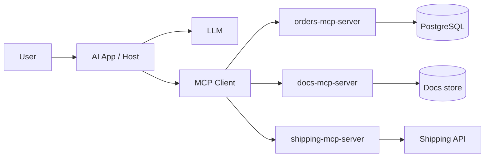
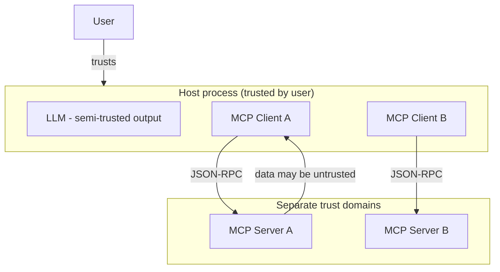
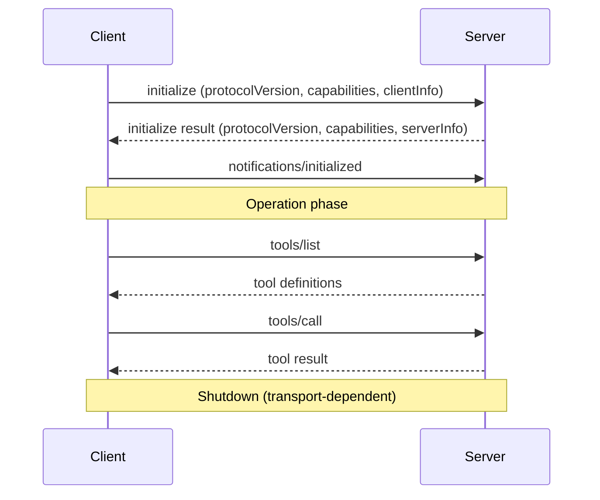
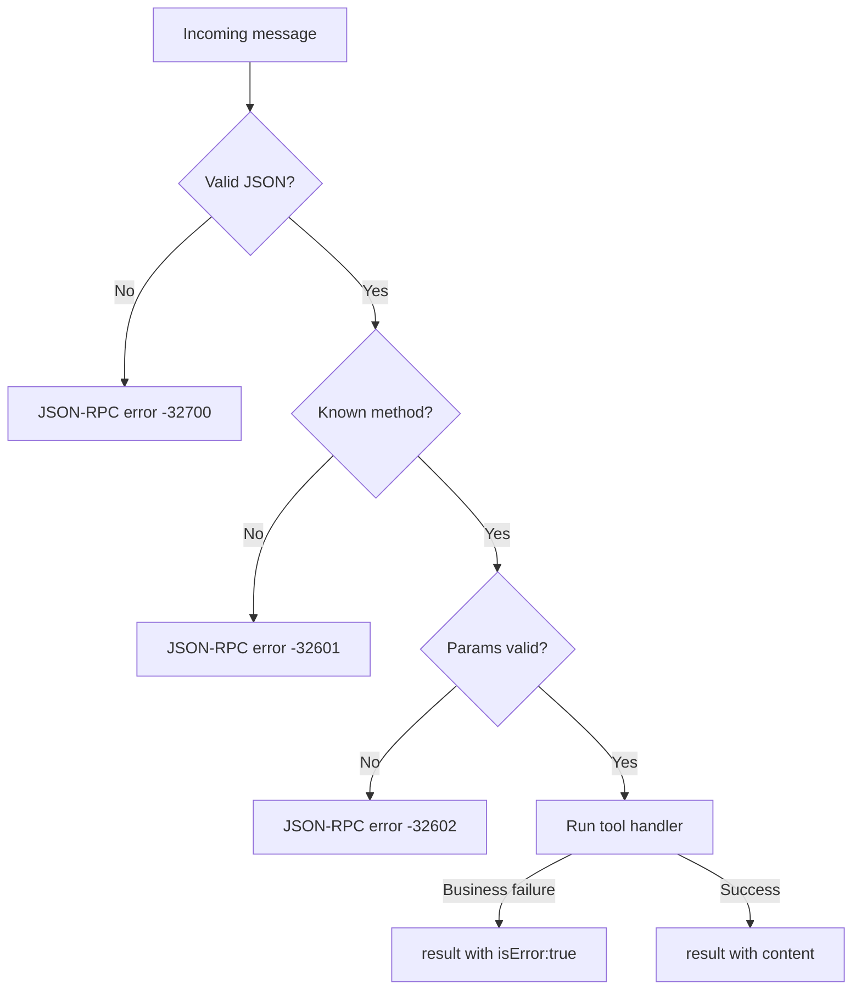

# MCP Servers — Complete Learning and Implementation Guide

> **Status of this document**
> This guide targets the Model Context Protocol as defined by the official specification and the official TypeScript SDK (`@modelcontextprotocol/sdk`).
> **Protocol version used in examples:** `2025-06-18` *(placeholder — verify the current `protocolVersion` string at https://modelcontextprotocol.io/specification/ before relying on it).*
> **Runtime assumptions:** Node.js ≥ 20 LTS, TypeScript ≥ 5.4, `@modelcontextprotocol/sdk` ≥ 1.x.
> Anything marked **[VERIFY]** is version-sensitive and should be checked against current official docs.

## How claims are categorized

Throughout, each non-obvious claim is tagged:

| Tag | Meaning |
|-----|---------|
| **[SPEC]** | Required/defined by the MCP specification |
| **[SDK]** | Behavior of the official TypeScript SDK (not the protocol) |
| **[CLIENT]** | Behavior specific to a particular AI client (e.g. Claude Desktop) |
| **[ENG]** | General engineering recommendation, not MCP-specific |
| **[OPT]** | Optional architecture pattern |
| **[VERIFY]** | Version-sensitive; confirm against live docs |

---

## Table of Contents

1. [Introduction to MCP](#chapter-1--introduction-to-mcp)
2. [MCP Architecture and Core Components](#chapter-2--mcp-architecture-and-core-components)
3. [MCP Protocol Internals](#chapter-3--mcp-protocol-internals)
4. [MCP Transports and Communication](#chapter-4--mcp-transports-and-communication)
5. [Tools, Resources, and Prompts](#chapter-5--mcp-tools-resources-and-prompts)
6. [Build an MCP Server from Scratch](#chapter-6--build-an-mcp-server-from-scratch)
7. [Connect an MCP Server to an AI Client](#chapter-7--connect-an-mcp-server-to-an-ai-client)
8. [Local Development and Execution](#chapter-8--local-development-and-execution)
9. [Configuration and Environment Management](#chapter-9)
10. [Error Handling and Resilience](#chapter-10)
11. [MCP Security Architecture](#chapter-11)
12. [OAuth, Tokens, and Secure Remote MCP](#chapter-12)
13. [Integrating Databases and External Services](#chapter-13)
14. [Testing and Quality Assurance](#chapter-14)
15. [Logging, Monitoring, and Observability](#chapter-15)
16. [Deploying MCP Servers to Production](#chapter-16)
17. [Production Scaling and Reliability](#chapter-17)
18. [MCP and AI Agent Frameworks](#chapter-18)
19. [Common Mistakes and Troubleshooting](#chapter-19)
20. [Complete Reference Project](#chapter-20)
21. [Learning Roadmap and Practical Exercises](#chapter-21)
22. [Glossary and Quick Reference](#chapter-22)

---

# Chapter 1 — Introduction to MCP

## 1.1 What is the Model Context Protocol?

**What it is.** The Model Context Protocol (MCP) is an **open protocol that standardizes how LLM-powered applications connect to external tools, data sources, and reusable prompts.** **[SPEC]** It defines a wire format (JSON-RPC 2.0), a lifecycle (initialize → operate → shutdown), and a set of capabilities (tools, resources, prompts, and more) that a *server* can expose and a *client* can consume.

The mental model that helps most people: **MCP is to AI tooling what USB-C is to hardware.** Before USB-C, every device had a bespoke connector. Before MCP, every AI app had a bespoke way of wiring in "search my docs," "query my DB," "call my API." MCP is the standard connector.

**Why it exists.** LLM applications kept re-implementing the same integration glue. If you built a database tool for one agent framework, you couldn't reuse it in another. If a vendor shipped an integration, it only worked with their client. MCP decouples **who provides a capability** (server authors) from **who consumes it** (AI app / client authors). Write a server once; any MCP-compatible client can use it.

## 1.2 What problems MCP solves — and what it doesn't

**Solves:**

- **N×M integration explosion.** Without a standard, *N* AI apps × *M* tools = *N×M* custom integrations. With MCP, it's *N + M*.
- **Reusability.** A "GitHub MCP server" works in Claude Desktop, a custom agent, an IDE, etc.
- **Consistent discovery.** Clients can *ask* a server "what can you do?" at runtime (tool/resource/prompt discovery).
- **A shared vocabulary** for tools, resources, prompts, sampling, and progress.

**Does NOT solve (important, and widely misunderstood):**

- **It is not an LLM** and does not perform reasoning. The *client/host* and *model* decide what to call. **[SPEC]**
- **It is not an agent framework.** It doesn't orchestrate multi-step plans, manage memory, or run reasoning loops.
- **It does not make tool calls safe.** A well-formed MCP `tools/call` is just a request; authorization and safety are *your* responsibility (Chapter 11).
- **It does not solve prompt injection.** Content returned from a resource or tool can contain adversarial instructions. MCP gives you the *structure* to mitigate this (trust boundaries), not a magic fix.
- **It is not a transport-specific thing.** It runs over STDIO, HTTP, or anything carrying JSON-RPC.

## 1.3 What existed before MCP

| Approach | What it was | Limitation MCP addresses |
|----------|-------------|--------------------------|
| Hand-rolled function calling | Each app defined tool JSON schemas inline and dispatched calls itself | Not reusable across apps; no discovery standard |
| OpenAPI → tool conversion | Generate tools from REST specs | REST wasn't designed for LLM context; no prompt/resource concept; no runtime capability negotiation |
| Vendor plugins (e.g. early ChatGPT plugins) | Vendor-specific manifests | Locked to one client |
| Framework-specific tools (LangChain `Tool`, etc.) | Framework-coupled | Not portable between frameworks |

## 1.4 How MCP differs from related things

### MCP vs REST API
A REST API is a general-purpose HTTP interface for *any* consumer. MCP is purpose-built for LLM consumption: it bundles **machine-readable tool descriptions**, **resources designed to be fed into context**, and **prompts**, plus **runtime discovery** and **capability negotiation**. You often *wrap* REST APIs inside MCP servers.

### MCP vs raw LLM function calling
Function calling is a *model feature*: the model emits a structured request to invoke a named function. MCP standardizes **where those function definitions come from, how they're discovered, and how they're executed** across apps. Function calling is the model side; MCP is the integration side. They're complementary — the client translates MCP tool definitions into whatever function-calling format its LLM provider expects.

### MCP vs agent frameworks
Agent frameworks (LangGraph, LangChain, etc.) handle **orchestration**: planning, loops, memory, routing. MCP handles **capability exchange**. A framework typically *contains* an MCP client. (Chapter 18.)

### MCP vs direct DB/service integration
Direct integration is faster to hack together but couples your AI logic to that specific data source and client. MCP adds a thin, standard boundary so the integration is portable and independently testable.

## 1.5 Capability comparison table

| Dimension | REST API | OpenAPI | LLM function calling | Agent framework | **MCP** | Direct integration |
|-----------|----------|---------|----------------------|-----------------|---------|--------------------|
| Designed for LLMs | No | No | Yes (model side) | Yes | **Yes** | No |
| Runtime capability discovery | No | Partial | No | Varies | **Yes** | No |
| Portable across clients | No | Somewhat | No | No | **Yes** | No |
| Standard tool/resource/prompt model | No | No | Tools only | Framework-specific | **Yes** | No |
| Handles orchestration/reasoning | No | No | No | **Yes** | No | No |
| Transport-flexible | HTTP only | HTTP only | N/A | Varies | **Yes (STDIO/HTTP)** | Varies |
| Built-in auth standard | No (you add) | No | N/A | Varies | **Yes (OAuth-based)** [VERIFY] | No |

## 1.6 A realistic motivating example

Imagine a support assistant that must:
1. **Query a PostgreSQL database** for a customer's orders.
2. **Search internal documentation** for troubleshooting steps.
3. **Call an external shipping API** for live tracking.

**Without MCP**, you'd embed three integrations directly in the app, define three tool schemas by hand, write dispatch logic, and redo it all if you switch frameworks or want to reuse it in a second product (e.g. an internal IDE assistant).

**With MCP**, you build:
- `orders-mcp-server` (tools: `getOrders`, `getOrderById`)
- `docs-mcp-server` (resources: `doc://...`, tool: `searchDocs`)
- `shipping-mcp-server` (tool: `trackShipment`)

Any MCP client connects to all three, discovers their capabilities, and exposes them to the LLM. Reuse them in a second app for free. Swap the LLM provider without touching the servers. Each server is independently deployable, testable, and securable.



---

# Chapter 2 — MCP Architecture and Core Components

## 2.1 The three roles: Host, Client, Server

These three terms confuse everyone at first. Here's the precise distinction. **[SPEC]**

| Component | What it is | Concrete example |
|-----------|-----------|------------------|
| **Host** | The LLM application the user interacts with. Owns the user, the model, and the trust decisions. Instantiates one or more clients. | Claude Desktop, an IDE assistant, your custom agent app |
| **Client** | A connector *inside* the host. Maintains a **1:1 connection** to exactly one server. Speaks the MCP protocol. | The MCP client object the SDK gives you |
| **Server** | A program exposing capabilities (tools/resources/prompts) over a transport. | `mcp-task-server`, a GitHub server |

Key relationships:
- One **host** manages many **clients**. **[SPEC]**
- Each **client** connects to exactly one **server** (1:1). **[SPEC]**
- A **server** does not know about the LLM and should never assume it. It just answers protocol requests.

**Trust boundaries (critical):**



- The **host** mediates. It must obtain user consent for sensitive operations and must not blindly trust model output or server-returned content. **[SPEC]**
- **Server-returned content is data, not trusted instructions.** This is the root of prompt-injection defense (Chapter 11).

## 2.2 The server capabilities

| Capability | Controlled by | Purpose | Analogy |
|-----------|---------------|---------|---------|
| **Tools** | Model (model-controlled) | Actions with side effects / computation | Function the model can call |
| **Resources** | App/host (application-controlled) | Readable context data | Files/documents to load into context |
| **Prompts** | User (user-controlled) | Reusable, parameterized prompt templates | Slash-commands / templates |

This **who controls it** distinction is central to MCP's design **[SPEC]**:
- **Tools** are invoked at the model's discretion (with host/user approval).
- **Resources** are selected by the *application* to include in context.
- **Prompts** are typically surfaced to the *user* (e.g. as slash commands).

## 2.3 Client capabilities (the other direction)

Servers can also request things *from* the client, if the client advertises support:

| Feature | Direction | What it does | Status |
|---------|-----------|--------------|--------|
| **Sampling** | Server → Client | Server asks the client's LLM to generate a completion | Optional; client must support |
| **Roots** | Client → Server | Client tells server which filesystem/URI roots it may operate in | Optional |
| **Elicitation** | Server → Client | Server requests structured input from the user mid-operation | **[VERIFY]** — newer feature |

**Why sampling exists:** so a server can use *the host's* model (and its credentials/quotas) rather than needing its own LLM key. The host stays in control and can approve/deny. **[SPEC]**

## 2.4 Notifications and progress

Besides request/response, MCP uses **notifications** — one-way messages with no reply. **[SPEC]** Examples:
- `notifications/tools/list_changed` — server tells client the tool list changed.
- `notifications/progress` — progress on a long operation.
- `notifications/message` — log messages from server to client.
- `notifications/cancelled` — a request was cancelled.

## 2.5 Capability negotiation & lifecycle

At connection start, client and server exchange **capabilities** so each knows what the other supports. This happens in the **initialization** phase. **[SPEC]**



Lifecycle phases **[SPEC]**:
1. **Initialization** — version + capability negotiation. No other requests until done (except `ping`).
2. **Operation** — normal request/response/notification traffic.
3. **Shutdown** — clean termination, transport-specific (close stdin for STDIO; close HTTP connection/session).

## 2.6 Example JSON messages

> All messages below are **illustrative** and conform to JSON-RPC 2.0 + MCP shapes. Field names like `protocolVersion` values are **[VERIFY]**.

**Initialize (request):**
```json
{
  "jsonrpc": "2.0",
  "id": 1,
  "method": "initialize",
  "params": {
    "protocolVersion": "2025-06-18",
    "capabilities": {
      "sampling": {},
      "roots": { "listChanged": true }
    },
    "clientInfo": { "name": "example-client", "version": "1.0.0" }
  }
}
```

**Initialize (result):**
```json
{
  "jsonrpc": "2.0",
  "id": 1,
  "result": {
    "protocolVersion": "2025-06-18",
    "capabilities": {
      "tools": { "listChanged": true },
      "resources": { "subscribe": true, "listChanged": true },
      "prompts": { "listChanged": true },
      "logging": {}
    },
    "serverInfo": { "name": "mcp-task-server", "version": "1.0.0" }
  }
}
```

**Initialized (notification — no id):**
```json
{ "jsonrpc": "2.0", "method": "notifications/initialized" }
```

**List tools (request/result):**
```json
{ "jsonrpc": "2.0", "id": 2, "method": "tools/list" }
```
```json
{
  "jsonrpc": "2.0",
  "id": 2,
  "result": {
    "tools": [
      {
        "name": "create_task",
        "description": "Create a new task",
        "inputSchema": {
          "type": "object",
          "properties": {
            "title": { "type": "string" },
            "priority": { "type": "string", "enum": ["low","medium","high"] }
          },
          "required": ["title"]
        }
      }
    ]
  }
}
```

**Call a tool (request/result):**
```json
{
  "jsonrpc": "2.0",
  "id": 3,
  "method": "tools/call",
  "params": {
    "name": "create_task",
    "arguments": { "title": "Write MCP guide", "priority": "high" }
  }
}
```
```json
{
  "jsonrpc": "2.0",
  "id": 3,
  "result": {
    "content": [
      { "type": "text", "text": "Created task #42: Write MCP guide (high)" }
    ],
    "isError": false
  }
}
```

**Tool execution error (note: this is a *result*, not a JSON-RPC error):**
```json
{
  "jsonrpc": "2.0",
  "id": 3,
  "result": {
    "content": [ { "type": "text", "text": "Validation failed: title is required" } ],
    "isError": true
  }
}
```

**List / read resource:**
```json
{ "jsonrpc": "2.0", "id": 4, "method": "resources/list" }
```
```json
{
  "jsonrpc": "2.0",
  "id": 5,
  "method": "resources/read",
  "params": { "uri": "task://stats/summary" }
}
```
```json
{
  "jsonrpc": "2.0",
  "id": 5,
  "result": {
    "contents": [
      {
        "uri": "task://stats/summary",
        "mimeType": "application/json",
        "text": "{\"open\":3,\"done\":12}"
      }
    ]
  }
}
```

**List / get prompt:**
```json
{
  "jsonrpc": "2.0",
  "id": 6,
  "method": "prompts/get",
  "params": { "name": "triage_task", "arguments": { "taskId": "42" } }
}
```
```json
{
  "jsonrpc": "2.0",
  "id": 6,
  "result": {
    "description": "Triage a task",
    "messages": [
      { "role": "user", "content": { "type": "text", "text": "Triage task 42 ..." } }
    ]
  }
}
```

**JSON-RPC protocol error (e.g. method not found):**
```json
{
  "jsonrpc": "2.0",
  "id": 7,
  "error": { "code": -32601, "message": "Method not found" }
}
```

**Progress notification:**
```json
{
  "jsonrpc": "2.0",
  "method": "notifications/progress",
  "params": { "progressToken": "abc", "progress": 50, "total": 100 }
}
```

---

# Chapter 3 — MCP Protocol Internals

## 3.1 JSON-RPC 2.0 fundamentals

MCP messages are JSON-RPC 2.0. **[SPEC]** There are exactly three message shapes:

| Shape | Has `id`? | Has `method`? | Expects reply? |
|-------|-----------|---------------|----------------|
| **Request** | Yes | Yes | Yes |
| **Response** | Yes (matches request) | No | — (it *is* the reply) |
| **Notification** | **No** | Yes | **No** |

Rules:
- Every message has `"jsonrpc": "2.0"`.
- A **request** must have an `id` (string or number, never null per MCP) and a `method`.
- A **response** has the same `id` and **either** `result` **or** `error`, never both.
- A **notification** has `method` but **no `id`** — and must never receive a response.

> **MCP constraint [SPEC]:** the request `id` must not be `null`, and must not be reused by the same sender within a session. This is stricter than base JSON-RPC.

## 3.2 Request IDs and correlation

Because MCP is bidirectional and supports concurrency, both sides may have multiple in-flight requests. The `id` correlates a response to its request. The SDK handles this for you, but understanding it matters for debugging: if you see a response with an `id` you don't recognize, something is desynced (often caused by **stdout pollution** on STDIO — see Chapter 4).

## 3.3 Error codes and structure

JSON-RPC reserved error codes **[SPEC]**:

| Code | Meaning | When |
|------|---------|------|
| `-32700` | Parse error | Invalid JSON received |
| `-32600` | Invalid Request | Not a valid request object |
| `-32601` | Method not found | Unknown method |
| `-32602` | Invalid params | Bad/missing params |
| `-32603` | Internal error | Server-side failure |
| `-32000` to `-32099` | Server-defined | Implementation-specific |

Error object shape:
```json
{ "code": -32602, "message": "Invalid params", "data": { "field": "title" } }
```

## 3.4 The three error layers (this trips everyone up)

This is one of the most important distinctions in MCP:

| Layer | How it's represented | Example | Who handles |
|-------|----------------------|---------|-------------|
| **1. JSON-RPC protocol error** | A JSON-RPC `error` response | Malformed JSON, unknown method, invalid params | Transport/SDK layer |
| **2. MCP-level error** | JSON-RPC `error` response with MCP semantics | Calling `tools/call` for a nonexistent tool, protocol version mismatch | SDK/server |
| **3. Tool execution error** | A **successful** JSON-RPC `result` with `isError: true` | "Customer not found", "DB timeout" inside a tool | Your business logic |

**Why this split matters:** A tool failing to do its job is **not** a protocol failure. The protocol worked perfectly — it delivered your "it failed" message. So tool failures go in the `result` with `isError: true`, **not** in a JSON-RPC `error`. This lets the *model* see and reason about the failure ("the order wasn't found, let me ask the user to recheck the ID") instead of the client treating it as a transport crash. **[SPEC]**



## 3.5 Initialization & version negotiation

During `initialize`, the client proposes a `protocolVersion`. **[SPEC]**
- If the server supports it, it echoes the same version.
- If not, the server responds with a version it *does* support.
- The client then decides whether it can proceed; if incompatible, it disconnects.

> **[VERIFY]** The exact negotiation rule (who wins, how fallback works) has nuance across spec revisions. For HTTP transport, the negotiated version is also sent via an `MCP-Protocol-Version` header **[VERIFY]**. Confirm current behavior.

## 3.6 Cancellation

A client can cancel an in-flight request via a `notifications/cancelled` notification referencing the request `id`. **[SPEC]**
```json
{
  "jsonrpc": "2.0",
  "method": "notifications/cancelled",
  "params": { "requestId": 3, "reason": "user aborted" }
}
```
- The server **should** stop work and free resources.
- The `initialize` request **must not** be cancelled this way. **[SPEC]**
- Cancellation is best-effort; a response may still arrive if it was already in flight (the client should ignore it).

**[ENG]** In your tool handlers, propagate an `AbortSignal` into DB/HTTP calls so cancellation actually stops downstream work (Chapter 10).

## 3.7 Progress notifications

Long operations can report progress **if the caller supplied a `progressToken`** in the request's `_meta`. **[SPEC]** Don't send progress without a token. Progress values should be monotonically increasing; `total` is optional.

## 3.8 Logging messages

If the server advertises the `logging` capability, it can emit `notifications/message` with a severity level (`debug`, `info`, `warning`, `error`, etc.). **[SPEC]** The client controls the minimum level via `logging/setLevel`. This is the **correct** channel for log data on STDIO — never `console.log` to stdout (Chapter 4).

## 3.9 Ping & connection health

Either side may send a `ping` request; the other must reply promptly with an empty result. **[SPEC]** Used to detect dead connections. If pings stop being answered, treat the connection as dead and clean up.

## 3.10 Timeouts & lifecycles

**[SPEC/ENG]** Each side should enforce timeouts on requests and may reset them on receiving progress. If a timeout fires, send a cancellation and clean up. Pick timeouts per operation type — a fast lookup and a long report generation need different limits.

## 3.11 Concurrency & state

MCP allows multiple concurrent requests. **[ENG]** Your server must be safe under concurrency:
- Don't store per-request state in module-level mutable globals.
- Use connection pooling for DBs.
- Make tool handlers reentrant.

## 3.12 Malformed / unexpected messages

**[ENG]** Defensive rules:
- Invalid JSON → respond `-32700` (if an id is even recoverable; otherwise drop).
- Unknown method → `-32601`.
- A response to an id you never sent → log and ignore (likely desync/stdout pollution).
- Never crash the whole process on one bad message; isolate per-message handling.

---