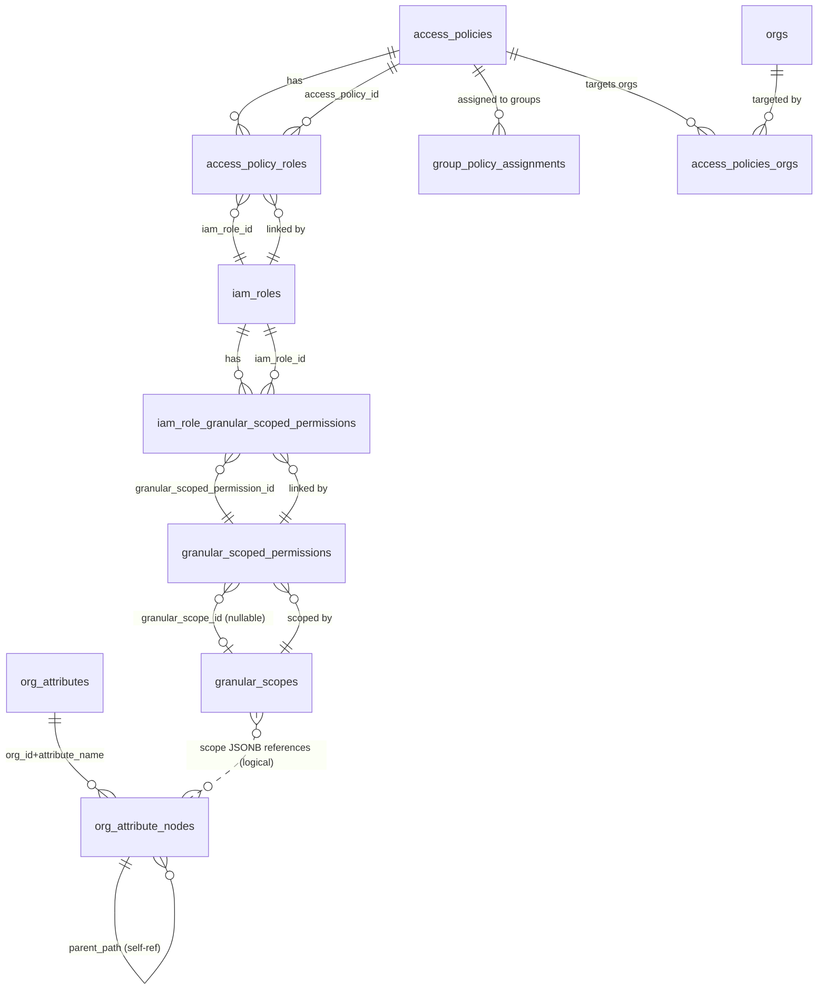

# Granular Access Policy — Database Schema & Relationships

This document describes all database tables involved in the **Granular Access Policy** feature
of the Granular Access Service (`iamgas`), their columns, constraints, indexes, and how they
relate to each other.

The schema is defined by the Sequel migrations in `db/migrate/` and mirrored by the Go table
definitions in `example/granular_access_service/model/globals.go`. The domain models live in
`example/granular_access_service/model/`.

---

## 1. Conceptual Overview

The feature lets an organization build reusable, composable access policies out of small
building blocks and then assign them to groups (and target customer orgs).

The composition hierarchy is:

```
Access Policy
  └── IAM Role(s)                         (via access_policy_roles)
        └── Granular Scoped Permission(s) (via iam_role_granular_scoped_permissions)
              ├── permissions[]           (what actions/data, e.g. Software, Hardware)
              ├── permission_category     (e.g. DataAccess)
              ├── role_names[]            (GRS role names)
              └── Granular Scope          (where it applies — the access boundary)
                     └── scope (JSONB)    → references Org Attributes / Attribute Nodes
```

Assignment / targeting:

```
Access Policy ──< group_policy_assignments >── GRS Group   (who gets the policy)
Access Policy ──< access_policies_orgs      >── Org         (which customer orgs it targets)
```

Organizational structure (the vocabulary the granular scope points at):

```
Org Attribute (e.g. "location", "businessUnit")
   └── Org Attribute Node(s)  (hierarchical tree, e.g. location/asia/india)
```

There are also two **virtual** (computed, non-persisted) entities used at evaluation time:
`PolicyAccessRule` and `PolicyAffiliation`.

---

## 2. Entity Relationship Diagram



> Note: The link between `granular_scopes.scope` (JSONB) and `org_attribute_nodes` is **logical**,
> not a database foreign key. The JSONB stores `attribute_name` + `node_paths` that correspond to
> `org_attributes.name` and `org_attribute_nodes.path`.

### 2.1 Text-Based (ASCII) Database Diagram

Legend: `PK` = primary key, `FK` = foreign key, `[N]` = many side, `[1]` = one side,
`──<` / `>──` point to the many side of a relationship.

```
                          ┌───────────────────────────────┐
                          │        access_policies        │
                          ├───────────────────────────────┤
                          │ PK id              uuid        │
                          │    org_id          integer     │
                          │    name            string      │
                          │    description     text        │
                          │    created_by      integer     │
                          │    created_at      datetime    │
                          │    updated_at      datetime    │
                          └───────────────────────────────┘
                            │ [1]           │ [1]        │ [1]
             ┌──────────────┘               │            └──────────────┐
             │ N                            │ N                         │ N
 ┌───────────────────────────┐  ┌───────────────────────────┐  ┌───────────────────────────┐
 │     access_policy_roles    │  │  group_policy_assignments  │  │    access_policies_orgs    │
 │      (junction: AP↔Role)   │  │   (junction: AP↔Group)     │  │     (junction: AP↔Org)     │
 ├───────────────────────────┤  ├───────────────────────────┤  ├───────────────────────────┤
 │ PK id            serial    │  │ PK id            serial    │  │ PK policy_id  uuid  FK ─┐   │
 │ FK access_policy_id uuid ──┘  │ FK access_policy_id uuid ──┘  │ PK org_id     integer FK│   │
 │ FK iam_role_id   uuid ──┐  │  │    grs_group_id  integer   │  │    created_at datetime   │   │
 │    org_id        integer│  │  │    policy_type   string    │  └─────────────┼───────────┘   │
 │    created_by    integer│  │  │    org_id        integer   │                │  points to    │
 │    created_at    datetime  │  │    created_by    integer   │                ▼  orgs(id)     │
 │    updated_at    datetime  │  │    created_at    datetime  │            ┌──────────┐         │
 └─────────────────┼──────────┘  │    updated_at    datetime  │            │   orgs   │ (ext.)  │
                   │ FK          └──────────────┼─────────────┘            └──────────┘         │
                   │ points to                  │ points to grs group (logical, no FK)          │
                   ▼                             ▼                                               │
 ┌───────────────────────────────┐         (GRS group id)                                       │
 │           iam_roles           │◄──────────────────────────────────────────────────────────┐ │
 ├───────────────────────────────┤                                                            │ │
 │ PK id              uuid        │                                                            │ │
 │    org_id          integer     │                                                            │ │
 │    name            string      │                                                            │ │
 │    description     text        │                                                            │ │
 │    created_by      integer     │                                                            │ │
 │    created_at      datetime    │                                                            │ │
 │    updated_at      datetime    │                                                            │ │
 └───────────────────────────────┘                                                            │ │
             │ [1]                                                                             │ │
             │ N                                                                               │ │
 ┌────────────────────────────────────────────┐                                               │ │
 │      iam_role_granular_scoped_permissions   │                                               │ │
 │        (junction: Role ↔ Permission)        │                                               │ │
 ├────────────────────────────────────────────┤                                               │ │
 │ PK id                            serial      │                                               │ │
 │ FK iam_role_id                   uuid ───────┘ (points to iam_roles.id)                      │ │
 │ FK granular_scoped_permission_id uuid ───────┐                                               │ │
 │    org_id                        integer     │                                               │ │
 │    created_by                    integer     │                                               │ │
 │    created_at / updated_at       datetime    │                                               │ │
 └──────────────────────────────────┼──────────┘                                               │ │
                                     │ points to                                               │ │
                                     ▼                                                          │ │
 ┌───────────────────────────────────────────────┐                                             │ │
 │          granular_scoped_permissions           │                                             │ │
 ├───────────────────────────────────────────────┤                                             │ │
 │ PK id                  uuid                     │                                             │ │
 │    name                string                  │                                             │ │
 │    description         text                    │                                             │ │
 │ FK granular_scope_id   uuid (nullable) ────────┼──┐                                          │ │
 │    org_id              integer                  │  │                                          │ │
 │    permissions         text[]  (nullable)      │  │                                          │ │
 │    permission_category string                  │  │                                          │ │
 │    role_names          text[]  (nullable)      │  │                                          │ │
 │    created_by          integer                 │  │                                          │ │
 │    created_at / updated_at datetime            │  │                                          │ │
 └───────────────────────────────────────────────┘  │ [N] points to [1]                        │ │
                                                     ▼                                          │ │
 ┌───────────────────────────────────────────────┐                                             │ │
 │                 granular_scopes                │                                             │ │
 ├───────────────────────────────────────────────┤                                             │ │
 │ PK id           uuid                           │                                             │ │
 │    name         string                         │                                             │ │
 │    description  text                            │                                             │ │
 │    scope        jsonb  ── [ {attribute_name,   │                                             │ │
 │                              node_paths[]}, …]  │                                             │ │
 │    org_id       integer                        │                                             │ │
 │    created_by   integer                        │                                             │ │
 │    created_at / updated_at datetime            │                                             │ │
 └───────────────────────┼───────────────────────┘                                             │ │
                         ┊ logical reference (no DB FK):                                        │ │
                         ┊ scope.attribute_name → org_attributes.name                          │ │
                         ┊ scope.node_paths[]   → org_attribute_nodes.path                     │ │
                         ▼                                                                      │ │
 ┌───────────────────────────────┐        ┌───────────────────────────────────────┐           │ │
 │        org_attributes         │ [1]──<N │           org_attribute_nodes         │           │ │
 ├───────────────────────────────┤        ├───────────────────────────────────────┤           │ │
 │ PK id            serial       │        │ PK path            string(500)         │           │ │
 │    org_id        integer      │        │    attribute_name  string(255)         │           │ │
 │    name          string(255)  │◄───────┤ FK (org_id, attribute_name)            │           │ │
 │    description   text         │        │    org_id          integer             │           │ │
 │    is_builtin    boolean      │        │    name            string(255)         │           │ │
 │    created_at    datetime     │        │    description     text                │           │ │
 │    updated_at    datetime     │        │ FK parent_path ────┐ (self-ref, tree)  │           │ │
 └───────────────────────────────┘        │    created_at / updated_at datetime    │           │ │
                                          │                    ▼                   │           │ │
                                          │        (points to org_attribute_       │           │ │
                                          │         nodes.path — subtree)          │           │ │
                                          └───────────────────────────────────────┘           │ │
                                                                                               │ │
 Notes:                                                                                        │ │
   • access_policy_roles.iam_role_id and iam_role_granular_scoped_permissions.iam_role_id ─────┘ │
     both point to iam_roles.id.                                                                 │
   • access_policies_orgs.policy_id ───────────────────────────────────────────────────────────┘
     points to access_policies.id; access_policies_orgs.org_id points to orgs.id.
```

**Reading the flow (top → bottom):** an `access_policy` fans out to three junction tables —
roles (`access_policy_roles`), group assignments (`group_policy_assignments`), and target orgs
(`access_policies_orgs`). Through roles it reaches `iam_roles`, which link to
`granular_scoped_permissions` (the WHAT), which point to `granular_scopes` (the WHERE). Scopes
logically reference the `org_attributes` / `org_attribute_nodes` hierarchy.

---

## 3. Core Tables

### 3.1 `granular_scopes`
Defines an **access boundary** — the "where" of a permission — using flexible JSONB data.

Source migration: `db/migrate/20250811_create_complete_iam_policies_schema.rb`

| Column | Type | Constraints | Notes |
| --- | --- | --- | --- |
| `id` | uuid | PK, default `uuid_generate_v4()` | Client-generatable for atomic hierarchical inserts |
| `name` | string | NOT NULL, non-empty | Unique per org |
| `description` | text | nullable | |
| `scope` | jsonb | NOT NULL | Array of `{ attribute_name, node_paths[] }` |
| `org_id` | integer | NOT NULL | Owning organization |
| `created_by` | integer | NOT NULL | User ID |
| `created_at` | datetime | NOT NULL, default now | |
| `updated_at` | datetime | NOT NULL, default now | |

- Unique: `(name, org_id)` → `granular_scope_name_org_unique`
- Check: `granular_scope_name_not_empty`
- Indexes: `org_id`; `(name, org_id)`; GIN on `scope` (`idx_granular_scopes_jsonb_gin`)
- Model: `model/granular_scope.go` (`GranularScope`, `Scope` is `json.RawMessage`)

**Example `scope` JSONB:**

```json
[
  { "attribute_name": "businessUnit", "node_paths": ["security", "finance"] },
  { "attribute_name": "location",     "node_paths": ["asia/india", "north_america/usa"] }
]
```

---

### 3.2 `granular_scoped_permissions`
A **granular permission** — the "what" (permissions/category) tied to a "where" (granular scope).

Source migrations:
- Create: `20250811_create_complete_iam_policies_schema.rb`
- `20251017_add_permission_to_granular_scoped_permissions.rb` (adds `permission`)
- `20251027_add_permission_category_to_granular_scoped_permissions.rb` (adds `permission_category`)
- `20251105_change_permission_to_permissions_array.rb` (replaces `permission` → `permissions` text[])
- `20260120_add_role_name_to_granular_scoped_permissions.rb` (drops `grs_role_id`, adds `role_names` text[])
- `20260129_alter_role_names_to_allow_null.rb` (`role_names` nullable)
- `20260130_alter_permission_to_allow_null.rb` (`permissions` and `granular_scope_id` nullable)

| Column | Type | Constraints | Notes |
| --- | --- | --- | --- |
| `id` | uuid | PK, default `uuid_generate_v4()` | |
| `name` | string | NOT NULL, non-empty | Unique per scope+org |
| `description` | text | nullable | |
| `granular_scope_id` | uuid | FK → `granular_scopes.id`, ON DELETE CASCADE, **nullable** (since 2026-01-30) | The access boundary |
| `org_id` | integer | NOT NULL | |
| `created_by` | integer | NOT NULL | |
| `created_at` | datetime | NOT NULL | |
| `updated_at` | datetime | NOT NULL | |
| `permissions` | text[] | **nullable** (since 2026-01-30), default `{}` | e.g. `{Software, Hardware}` |
| `permission_category` | string | nullable | e.g. `DataAccess` |
| `role_names` | text[] | **nullable** (since 2026-01-29), default `{}` | GRS role names |

Historical columns (no longer present):
- `permission` (string) — replaced by `permissions` (text[])
- `grs_role_id` (integer) — replaced by `role_names` (text[])

- Unique: `(name, granular_scope_id, org_id)` → `granular_scoped_permissions_name_granular_scope_org_unique`
- Check: `granular_scoped_permissions_name_not_empty`
- Indexes: `org_id`; `granular_scope_id`; (historically `grs_role_id` and `(granular_scope_id, grs_role_id)`); GIN on `permissions`; GIN on `role_names`; index on `permission_category`
- Model: `model/granular_scoped_permission.go` (`GranularScopedPermission`, holds optional nested `GranularScope`)

**Relationship:** many `granular_scoped_permissions` → one `granular_scopes` (nullable).

---

### 3.3 `iam_roles`
A **role container** that groups multiple granular scoped permissions.

Source migration: `20250811_create_complete_iam_policies_schema.rb`

| Column | Type | Constraints | Notes |
| --- | --- | --- | --- |
| `id` | uuid | PK, default `uuid_generate_v4()` | |
| `name` | string | NOT NULL, non-empty | Unique per org |
| `description` | text | nullable | |
| `org_id` | integer | NOT NULL | |
| `created_by` | integer | NOT NULL | |
| `created_at` | datetime | NOT NULL | |
| `updated_at` | datetime | NOT NULL | |

- Unique: `(name, org_id)` → `iam_roles_name_org_unique`
- Check: `iam_roles_name_not_empty`
- Indexes: `org_id`; `(name, org_id)`
- Model: `model/iam_role.go` (`IAMRole`, holds nested `GranularScopedPermissions`)

---

### 3.4 `access_policies`
A **high-level policy container** that groups multiple IAM roles.

Source migration: `20250811_create_complete_iam_policies_schema.rb`

| Column | Type | Constraints | Notes |
| --- | --- | --- | --- |
| `id` | uuid | PK, default `uuid_generate_v4()` | |
| `name` | string | NOT NULL, non-empty | Unique per org |
| `description` | text | nullable | |
| `org_id` | integer | NOT NULL | |
| `created_by` | integer | NOT NULL | |
| `created_at` | datetime | NOT NULL | |
| `updated_at` | datetime | NOT NULL | |

- Unique: `(name, org_id)` → `access_policies_name_org_unique`
- Check: `access_policies_name_not_empty`
- Indexes: `org_id`; `(name, org_id)`
- Model: `model/access_policy.go` (`AccessPolicy`, holds nested `IAMRoles`, plus `GroupIDs` and `CustomerOrgIDs` resolved via junction tables)

---

## 4. Junction (Many-to-Many) Tables

### 4.1 `iam_role_granular_scoped_permissions`
Links **IAM roles** to their **granular scoped permissions**.

Source migration: `20250811_create_complete_iam_policies_schema.rb`

| Column | Type | Constraints |
| --- | --- | --- |
| `id` | serial | PK |
| `iam_role_id` | uuid | FK → `iam_roles.id`, ON DELETE CASCADE, NOT NULL |
| `granular_scoped_permission_id` | uuid | FK → `granular_scoped_permissions.id`, ON DELETE CASCADE, NOT NULL |
| `org_id` | integer | NOT NULL |
| `created_by` | integer | NOT NULL |
| `created_at` | datetime | NOT NULL |
| `updated_at` | datetime | NOT NULL |

- Unique: `(iam_role_id, granular_scoped_permission_id)` → `iam_role_granular_scoped_permissions_unique`
- Indexes: `iam_role_id`; `granular_scoped_permission_id`; `org_id`; `(iam_role_id, granular_scoped_permission_id)`

---

### 4.2 `access_policy_roles`
Links **access policies** to **IAM roles**.

Source migration: `20250811_create_complete_iam_policies_schema.rb`

| Column | Type | Constraints |
| --- | --- | --- |
| `id` | serial | PK |
| `access_policy_id` | uuid | FK → `access_policies.id`, ON DELETE CASCADE, NOT NULL |
| `iam_role_id` | uuid | FK → `iam_roles.id`, ON DELETE CASCADE, NOT NULL |
| `org_id` | integer | NOT NULL |
| `created_by` | integer | NOT NULL |
| `created_at` | datetime | NOT NULL |
| `updated_at` | datetime | NOT NULL |

- Unique: `(access_policy_id, iam_role_id)` → `access_policy_roles_unique`
- Indexes: `access_policy_id`; `iam_role_id`; `(access_policy_id, iam_role_id)`

---

### 4.3 `group_policy_assignments`
Assigns an **access policy** to a **GRS group** (the "who").

Source migration: `20250811_create_complete_iam_policies_schema.rb`

| Column | Type | Constraints |
| --- | --- | --- |
| `id` | serial | PK |
| `grs_group_id` | integer | NOT NULL — GRS group ID |
| `access_policy_id` | uuid | FK → `access_policies.id`, ON DELETE CASCADE, NOT NULL |
| `policy_type` | string | NOT NULL, must be `'access_policy'` |
| `org_id` | integer | NOT NULL |
| `created_by` | integer | NOT NULL |
| `created_at` | datetime | NOT NULL |
| `updated_at` | datetime | NOT NULL |

- Unique: `(grs_group_id, access_policy_id, policy_type)` → `group_policy_assignments_unique`
- Checks: `assignment_policy_type_valid` (`policy_type IN ('access_policy')`); `group_policy_assignments_type_not_empty`
- Indexes: `grs_group_id`; `access_policy_id`; `policy_type`; `org_id`

---

### 4.4 `access_policies_orgs`
Links an **access policy** to the target **customer organizations** it applies to.

Source migration: `db/migrate/20260114_create_access_policies_orgs.rb`

| Column | Type | Constraints |
| --- | --- | --- |
| `policy_id` | uuid | FK → `access_policies.id`, ON DELETE CASCADE, NOT NULL, part of composite PK |
| `org_id` | integer | FK → `orgs.id`, ON DELETE CASCADE, NOT NULL, part of composite PK |
| `created_at` | datetime | NOT NULL, default now |

- Composite PK: `(policy_id, org_id)` — prevents duplicate policy-org assignments
- Index: `org_id` → `idx_access_policies_orgs_org_id` (reverse lookup: policies for an org)

---

## 5. Organizational Structure Tables

These define the vocabulary that granular scopes reference.

### 5.1 `org_attributes`
An organizational attribute dimension (e.g. `location`, `cost_center`, `businessUnit`).

Source migration: `db/migrate/20251015_create_org_attributes_and_nodes.rb`

| Column | Type | Constraints |
| --- | --- | --- |
| `id` | serial | PK |
| `org_id` | integer | NOT NULL |
| `name` | string(255) | NOT NULL |
| `description` | text | nullable |
| `is_builtin` | boolean | NOT NULL, default false |
| `created_at` | datetime | NOT NULL |
| `updated_at` | datetime | NOT NULL |

- Unique: `(org_id, name)` → `uq_org_attributes_org_id_name`
- Indexes: `org_id`; `name`; `is_builtin`
- Model: `model/org_attribute.go`

---

### 5.2 `org_attribute_nodes`
A node in an attribute's **hierarchy tree** (e.g. `location/asia/india`). Self-referential.

Source migration: `db/migrate/20251015_create_org_attributes_and_nodes.rb`

| Column | Type | Constraints |
| --- | --- | --- |
| `path` | string(500) | **PK** — unique path identifier (e.g. `location/asia/india`) |
| `attribute_name` | string(255) | NOT NULL — the owning attribute's name |
| `org_id` | integer | NOT NULL |
| `name` | string(255) | NOT NULL — node display name |
| `description` | text | nullable |
| `parent_path` | string(500) | nullable (null = root node) |
| `created_at` | datetime | NOT NULL |
| `updated_at` | datetime | NOT NULL |

- FK: `parent_path` → `org_attribute_nodes.path`, ON DELETE/UPDATE CASCADE (self-reference)
- FK: `(org_id, attribute_name)` → `org_attributes.(org_id, name)`, ON DELETE/UPDATE CASCADE
- Unique: `(org_id, attribute_name, parent_path, name)`
- Indexes: `parent_path`; `(org_id, attribute_name)`; `org_id`; `attribute_name`;
  and a `varchar_pattern_ops` btree index on `path` (`idx_org_attribute_nodes_path_prefix`) for prefix/subtree queries
- Model: `model/org_attribute_node.go`

**Link to granular scopes:** each entry in `granular_scopes.scope` uses `attribute_name`
(matching `org_attributes.name`) and `node_paths` (matching `org_attribute_nodes.path`).
This is enforced at the application layer, not by DB foreign keys.

---

## 6. Virtual (Computed) Entities

These are **not persisted**; they are computed at runtime during policy evaluation.

### 6.1 `PolicyAccessRule` (`model/policy_access_rule.go`)
Computed access rule derived from an access policy.

| Field | Type | Description |
| --- | --- | --- |
| `scope_href` | string | Resource scope reference (e.g. `/grs/orgs/100`) |
| `subject_href` | string | Subject reference (e.g. `/grs/users/10001`) |
| `role_href` | string | Role reference (e.g. `/grs/roles/1`) |
| `policy_id` | string | Source access policy ID |

### 6.2 `PolicyAffiliation` (`model/policy_affiliation.go`)
Computed affiliation of a user to an org/group via a policy.

| Field | Type | Description |
| --- | --- | --- |
| `user_id` | uint64 | User |
| `org_id` | uint64 | Organization |
| `policy_id` | string | Source access policy |
| `group_id` | uint64 | Group granting the affiliation |
| `active` | bool | Whether affiliation is active |

---

## 7. Relationship Summary

| From | Relationship | To | Via |
| --- | --- | --- | --- |
| `access_policies` | 1 — N | `iam_roles` | `access_policy_roles` |
| `iam_roles` | 1 — N | `granular_scoped_permissions` | `iam_role_granular_scoped_permissions` |
| `granular_scoped_permissions` | N — 1 | `granular_scopes` | `granular_scope_id` (FK, nullable) |
| `access_policies` | 1 — N | GRS groups | `group_policy_assignments` |
| `access_policies` | 1 — N | `orgs` | `access_policies_orgs` |
| `org_attributes` | 1 — N | `org_attribute_nodes` | `(org_id, attribute_name)` FK |
| `org_attribute_nodes` | 1 — N | `org_attribute_nodes` | `parent_path` (self FK) |
| `granular_scopes` | logical N — N | `org_attribute_nodes` | `scope` JSONB (`attribute_name` + `node_paths`) |

### Cascade behavior
- Deleting an `access_policy` cascades to `access_policy_roles`, `group_policy_assignments`, and `access_policies_orgs`.
- Deleting an `iam_role` cascades to `access_policy_roles` and `iam_role_granular_scoped_permissions`.
- Deleting a `granular_scoped_permission` cascades to `iam_role_granular_scoped_permissions`.
- Deleting a `granular_scope` cascades to its `granular_scoped_permissions` (FK ON DELETE CASCADE).
- Deleting an `org` cascades to `access_policies_orgs`.
- Deleting an `org_attribute` cascades to its `org_attribute_nodes`; deleting a node cascades to descendants.

---

## 8. Bootstrap Table Registration

For non-migration environments, the Go service registers these tables via
`model/globals.go` in `AccessPolicyServiceTables`:

`access_policies`, `iam_roles`, `granular_scopes`, `granular_scoped_permissions`,
`iam_role_granular_scoped_permissions`, `access_policy_roles`, `access_policies_orgs`.

And `OrgStructureServiceTables`: `org_attributes`, `org_attribute_nodes`.

---

## 9. Reference Files

| Concern | File |
| --- | --- |
| Full normalized schema (create) | `db/migrate/20250811_create_complete_iam_policies_schema.rb` |
| Org attributes & nodes | `db/migrate/20251015_create_org_attributes_and_nodes.rb` |
| Policy → org junction | `db/migrate/20260114_create_access_policies_orgs.rb` |
| Permissions column evolution | `db/migrate/2025101*`, `2025110*`, `2026012*`, `2026013*` |
| Table / column name constants | `example/granular_access_service/model/globals.go` |
| Domain models | `example/granular_access_service/model/*.go` |
| End-to-end usage examples | `example/granular_access_service/extra/examples.md` |

---

## 10. How to Explain This to a Senior Manager

Managers care about **business value, risk, and scale** — not table names. Lead with the "why,"
keep the schema as backup, and only drill into tables if asked. Use this top-down script.

### 10.1 The 30-second pitch (the problem)

> "Today access control is coarse — a user either has a role across the whole org or not.
> Large customers need finer control, like *'this team can only see Software data for the India
> region in the Security business unit.'* Our old model couldn't express that. I designed and
> built **Granular Access Policies** to make exactly this possible."

### 10.2 The mental model — "What / Where / Who"

Explain the whole system with three words instead of eleven tables:

| Concept | Question it answers | Backed by |
| --- | --- | --- |
| **What** | Which permissions/data? (e.g. Software, Hardware → DataAccess) | `granular_scoped_permissions` |
| **Where** | Which slice of the org? (e.g. location = India, BU = Security) | `granular_scopes` + org attributes |
| **Who** | Which users get it? | `group_policy_assignments` (groups) |

Then the one-line composition story:

> "Small reusable blocks compose upward: **Permissions + Scope → Roles → Access Policy**, and the
> policy gets **assigned to groups** and **targeted at customer orgs**."

```
Permissions + Scope  →  IAM Role  →  Access Policy  →  assigned to Groups / Orgs
   (what + where)        (bundle)      (the thing         (who / which orgs)
                                        you hand out)
```

### 10.3 Why the design is solid (shows engineering maturity)

Pick 3–4 points — these map to what managers worry about:

- **Reusable & composable** → define a scope or role once, reuse everywhere. Less duplication,
  faster policy authoring, fewer mistakes.
- **Data integrity is guaranteed by the database** → proper foreign keys, uniqueness constraints,
  and cascade deletes mean no orphaned or half-created data.
- **Atomic creation** → client-generated UUIDs let us create a full policy (policy + roles +
  permissions + scope) in a **single transaction** — fewer round trips, no partial state.
- **Built to scale** → JSONB + hierarchy tree means "all of Asia" works without listing every
  country; GIN/composite indexes are tuned for the real query patterns.

### 10.4 Status & impact (close strong)

> "It's fully designed, migrated, documented, and mirrored in code. The schema went through
> several deliberate iterations as requirements sharpened — for example, single permission →
> multiple permissions, and hard-coded role IDs → flexible role names. It's ready for
> [integration / testing / rollout]."

### 10.5 Anticipate the top 3 questions

| They'll ask… | Answer with… |
| --- | --- |
| "How does this scale?" | Indexing strategy + single-transaction creation + hierarchy avoids row explosion. |
| "How do we know it's correct and safe?" | DB-enforced integrity (FKs, unique + check constraints, cascades) plus test coverage. |
| "How does a customer actually use it?" | The CLI/API examples in `examples.md` (create policy → assign to group → evaluate). |

### 10.6 Do / Don't

- **Do** lead with the customer outcome, keep it to the What/Where/Who model, and have the
  diagram (Section 2) open as backup.
- **Don't** walk through all 11 tables, dive into column types, or open with the schema — drill
  down only if they ask.

